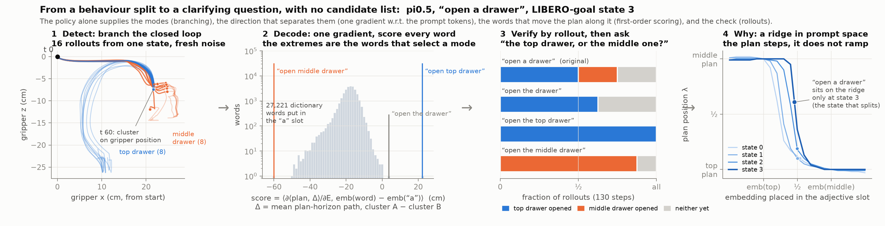
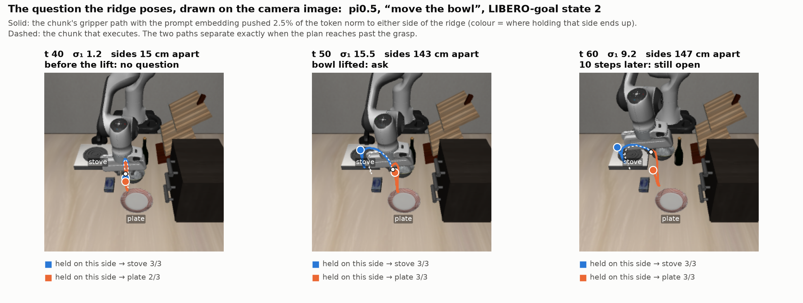
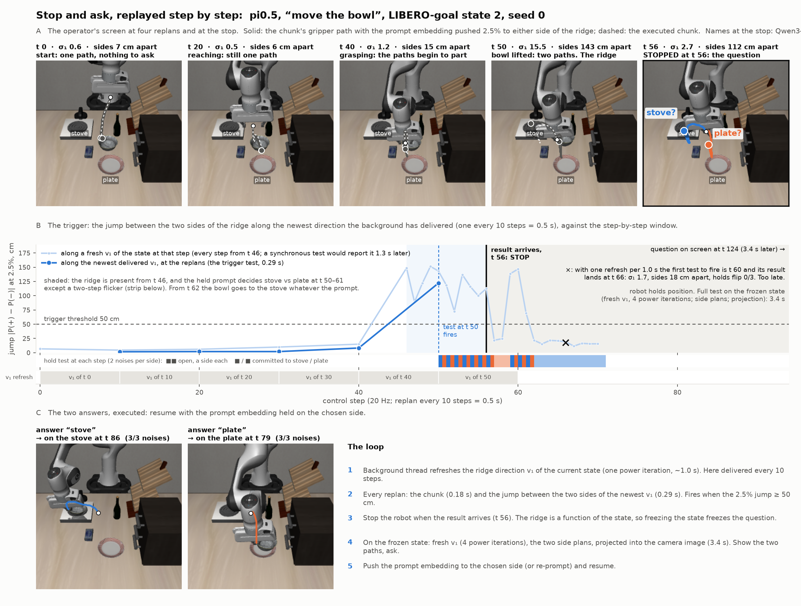
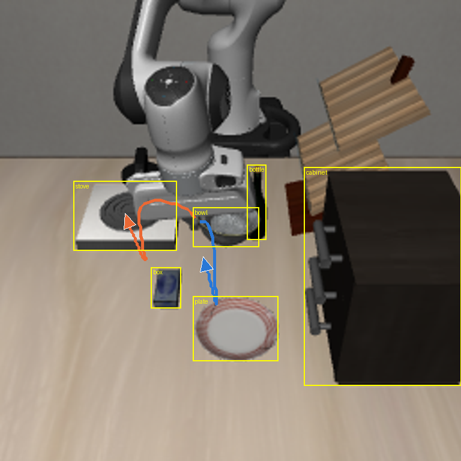
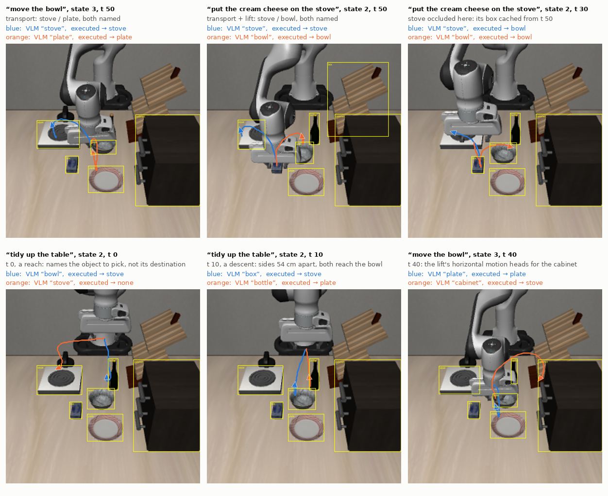

# pi0.5 on LIBERO (MuJoCo manipulation)

First step from the 2-D tasks (robot2–robot4) to a realistic manipulation simulator: a pretrained
VLA, **pi0.5** (`lerobot/pi05_libero_finetuned_v044`, no training of ours), controlling a Franka
Panda in **LIBERO** (MuJoCo / robosuite, OSC delta-pose control at 20 Hz), analysed as a flow map
in noise space as before.

## Setup

```bash
CMAKE_POLICY_VERSION_MINIMUM=3.5 uv pip install --python .venv/bin/python "hf-libero>=0.1.4,<0.2.0"
echo N | .venv/bin/python -c "import libero.libero"   # writes ~/.libero/config.yaml (it prompts otherwise)
.venv/bin/hf download lerobot/pi05_libero_finetuned_v044
export MUJOCO_GL=egl                                  # set by env5.py
```

`egl-probe` (a robomimic dependency) only builds with the CMake policy override. The PaliGemma
tokenizer repo (`google/paligemma-3b-pt-224`) is gated; `pi05flow.SPTokenizer` wraps robot4's
local sentencepiece copy behind the HF call signature that lerobot's preprocessor uses.

## Task

LIBERO-spatial: 10 tasks × 50 fixed initial states. Every scene has two identical black bowls
(`akita_black_bowl_1` is the one the instruction names, `_2` the distractor) and a plate; the
instruction picks the bowl by spatial relation ("…the black bowl on the stove…"). The mode of
a rollout is **the bowl lifted first**. Ambiguous prompt: "pick up the black bowl and place it
on the plate".

## Files

| File | What |
|---|---|
| `env5.py` | `Scene(task, init, layout)`: lerobot's `LiberoEnv` + its observation pipeline (256² cameras, 180° flip, 8-D state). Exact save/restore for branching. |
| `pi05flow.py` | pi0.5 as a differentiable flow map; `python pi05flow.py check`. |
| `rollout5.py` | Seeded closed-loop rollouts (`sanity`, `ambig`, `layouts`, `report`). Replans every 10 steps. |
| `lcs5.py` | Chunk-level mode label (`calib`) and the robot4-style noise-space LCS scan (`scan`, not yet run). |
| `decide5.py` | Branching study: at each replan state, closed-loop basin of each noise seed + chunk FTLE. |
| `vec5.py` | Batched closed loop: one scene per worker process, policy batched on the GPU. Workers are respawned per scene (LIBERO leaks ~0.5–1 GB per scene build); ~2.3 GB each, 8 workers on a 62 GB machine (16 ran it out of memory). |
| `order5.py` | LIBERO-10 subtask-order screen (`screen`, `report`) and decision-state branching (`decide`). |
| `video5.py` | Videos of rollouts as the policy sees them (`videos/`). |

## pi0.5 as a flow map (`pi05flow.py`)

Differences from pi0 (robot4): the 8-D state is discretised into the prompt, so the prefix K/V
cache is the whole conditioning (images + language + state) and there is no state token; flow
time enters through adaRMSNorm (scale, shift, gate on every expert norm), precomputed per Euler
step since it does not depend on the actions. Chunk 50 × 32 (7 real dims): noise space 1600-D,
task chunk 350-D. 10 Euler steps from t = 1, as lerobot. VLM prefix in float32.

| check | result |
|---|---|
| explicit flow vs lerobot `sample_actions`, same noise (fp32, 3 scenes) | max diff 7e-6 (actions up to 2.6) |
| ∂Φ/∂z (reverse mode) vs central FD, 8 directions × 3 scenes (fp64) | 1.6e-9 relative |
| Jacobian 350 × 1600, fp32, RTX 5090 | 4.6 s / seed (18 GB peak at 2 seeds per vmap) |

## Reproducibility: hidden state in LIBERO / robosuite

Three things are not in MuJoCo's `get_state()`; all three changed results until handled:

1. **Fixture layout.** LIBERO's init states set joint positions only. Fixtures without joints
   (stove, cabinet) are re-placed at random (~1 cm) on every hard reset: at identical physics
   state, ~11% of the camera pixels change and pi0.5's chunk moves by up to 4 (normalised
   units). `Scene(..., layout=k)` seeds the reset, making (task, init, layout) one scene.
2. **Observable sampling timers.** robosuite samples cameras and proprio at the start of each
   50 ms control period on a float timer; the timer phase is hidden state.
3. **Gripper command.** The Panda gripper ramps an internal `current_action`.

`get_state`/`set_state` carry 2 and 3; replays from a restored state match to 1e-14 with
identical pixels, including the gripper closing. Rollouts with the same (layout, seed) are
identical. Results produced before these fixes are in `out/unseeded/` (do not use, except the
sanity success rate below, which does not depend on them).

## Results so far

**The checkpoint works through the explicit flow** (each task's own instruction, 3 inits, unseeded
layouts): 29/30 successes; the named bowl is lifted in 30/30.

**Under the ambiguous prompt the bowl is set by the scene, not by the noise.**

- Initial survey (10 tasks × 2 inits × 8 seeds, unseeded layouts): in 19 of 20 scenes the lifted
  bowl was the same for every seed that lifted one (bowl 1 in 18, bowl 2 in scene (7, 1)). The
  likely reason: in LIBERO-spatial each layout comes with one instruction in training, so the
  image alone identifies the task.
- The one apparently seed-dependent scene, (7, 0), was the fixture layout. With the layout
  seeded (`rollout5.py layouts`, 6 layouts × 8 seeds):

  | layout | 0 | 1 | 2 | 3 | 4 | 5 |
  |---|---|---|---|---|---|---|
  | (7, 0) | bowl 1 ×8 | bowl 2 ×8 | bowl 2 ×8 | bowl 1 ×8 | bowl 1 ×8 | bowl 1 ×8 |
  | (7, 1) | bowl 2 ×7, none ×1 | bowl 2 ×8 | bowl 2 ×8 | bowl 2 ×8 | bowl 2 ×8 | bowl 2 ×8 |

  Within a layout, the noise never changes the bowl; a ~1 cm move of the stove (on which bowl 1
  sits in task 7) flips it.
- Consistently, along two rollouts in (7, 0) (`decide5.py`, one layout per rollout), branching 8
  noise seeds × 2 shared future-noise streams at every replan until the lift: every branch lifted
  the same bowl, and the chunk FTLE was mostly negative (median −0.2 to −1.0 over the full chunk,
  −0.75 to −1.8 over the 10 executed steps).
- In the unseeded run, the first chunk did not commit to a bowl in scene (7, 0): every seed's
  chunk ended between the two bowls. Where a decision is made, it is made at a later replan.

**Implication.** On LIBERO-spatial, pi0.5 has no noise-space mode boundary to find; the
switching boundary lives in conditioning space (the image: here, a fixture's position). This
is the setting of the paper's conditioning-change question, but the robot2–4 machinery (FTLE
and LCS in z) has nothing to detect at fixed conditioning. Options:

1. Conditioning-space LCS: parameterise the scene (stove offset, bowl positions) and locate
   the switching boundary by bisection; test whether ∂Φ/∂(parameter) through the full VLA
   predicts it.
2. Look for genuine noise-space multimodality elsewhere: other LIBERO suites (LIBERO-object
   with ambiguous object prompts, LIBERO-90 / 10), or a policy with weaker scene→task
   shortcuts.

## Subtask order on LIBERO-10 (`order5.py screen`)

Six LIBERO-10 tasks move two objects with an order the instruction does not force
(`env5.TRACK10`: "put both the alphabet soup and the tomato sauce in the basket", "put both
moka pots on the stove", "put the white mug on the left plate and put the yellow and white mug
on the right plate", …). Mode = the object lifted first. 6 tasks × 6 initial states × 8 noise
seeds, layout 0, own instruction (288 episodes, ~15 min on 8 workers):

| task | first object lifted |
|---|---|
| 0, 1, 7 ("put both X and Y …") | X, the object named first, 144/144 |
| 4, 6 ("put the white mug on … and put …") | the white mug (named first), 96/96 |
| 8 ("put both moka pots on the stove") | always moka_pot_2, 48/48 |

**The noise never changes the order (0 of 36 scenes).** Together with LIBERO-spatial, this
checkpoint shows no task-level mode that the noise decides: object, bowl and order are all set
by the scene and the prompt. What the noise does change is timing and execution: the time of
the first lift spreads from a few steps (most scenes) to 69–210 (task 7 init 0) and 102–138
(task 7 init 4), probably missed grasps and retries (not checked). A one-step difference in
when the gripper closes is a hard FTLE ridge in noise space, but crossing it changes nothing
downstream (scene (7, 0) of LIBERO-spatial, paired branching with shared future noise, 3 streams,
first chunk executed for 10 or 50 steps: same bowl, same lift step ±1, final positions within
0.2–1.3 cm, less than
between two unrelated seeds).

## Chunk label (`lcs5.py calib`, unseeded; needs a rerun)

The chunk's position actions are OSC goal offsets of 0.05 m per unit. Measured tracking over
an open-loop 50-step chunk: gain 0.25 (path error 2.7 cm after 50 steps). As a label for the
lifted bowl, "nearest bowl to the predicted grasp point / path" agreed 95–99% with the
closed-loop outcome, but that agreement is dominated by unambiguous scenes; in the scene that
mattered, (7, 0), no first-chunk label predicted the outcome (see above).

## LIBERO-goal: which prompts let the noise decide? (`goal5.py`)

LIBERO-goal is one kitchen scene (the BDDL scene is identical for all 10 tasks; only goal and
wording differ) with 10 trained instructions, all in pi0.5's training set (HuggingFaceVLA/libero
has all 40 LIBERO tasks). With the scene fixed, the prompt is the only conditioning that changes.
Scene: task 0's environment, initial states 0–3, fixture layout 0. 34 prompts × 4 initial states ×
8 noise seeds, closed loop, seeds shared across prompts (common random numbers). Episode label =
first of env5.GOALS (10 task goals) or a placement event (env5.EVENTS: bottle/cheese on stove or
plate, bowl/cheese in a drawer) reached; else the last drawer opened; else none. 300 steps.
`python goal5.py screen && python goal5.py run && python goal5.py report` (43 min on 8 workers).

Same seed on different workers gives the same label and the same observations (checked), so the
splits below are the noise, not the worker.

| prompts | (prompt, initial state) cells | noise splits the outcome (minority ≥ 2 of 8 seeds) |
|---|---|---|
| 10 trained | 40 | 0 (2 single stragglers) |
| 10 paraphrases | 40 | 0 (3 single stragglers) |
| 11 underspecified | 44 | **10** |
| 3 novel compositions | 12 | **4** |

- **Trained prompts: deterministic.** 99% success except "open the middle drawer" from initial
  state 1, which opens the bottom drawer with all 8 seeds (a scene-determined failure).
- **Paraphrases behave exactly like the trained wording**, down to the same seed-by-seed
  stragglers ("place the bowl on the stove" fails at the same seed as "put the bowl on the
  stove"): "second drawer", "burner", "switch on", "in the rack" are all grounded.
- **Underspecified prompts are where the noise decides.** Examples (labels by seed 0–7):
  "open a drawer", initial state 3: middle drawer / bowl into top drawer alternating 4:4; "move
  the bowl", initial states 2–3: stove vs plate 6:2 and 3:5; "tidy up the table": bowl to plate
  vs stove 4:4. Others resolve to one default with every seed: "put the wine bottle somewhere" →
  rack (never cabinet top), "put something on the plate" → bowl. Some resolve by scene:
  "put something on top of the cabinet" → bottle from initial state 2, bowl from the others.
- **Keyword grounding.** "put something on the stove" turns the stove on (32/32): the words
  "on" + "stove" select the trained task "turn on the stove".
- **Novel compositions** partly work (cheese → plate 62%, cheese → stove 56%, bottle → stove
  16%) and fall back to a trained task otherwise (cheese → bowl, plate → stove front), sometimes
  by noise.
- **The first plan does not show the split.** Open loop, the first chunk's predicted eef path
  varies by ≤ 1.3 cm over 128 seeds, and no (prompt, initial state) is bimodal (Sarle's coefficient
  ≤ 0.53), including the cells that split in closed loop. The decision is made later in the
  episode, outside the first chunk (as in robot2: one-chunk FTLE only sees decisions inside the
  chunk).

### Where the noise decides: branching along a rollout (`branch5.py`)

At every replan state of a main closed-loop rollout (goal5's seed 0), 8 noise seeds for the
current chunk × 2 shared future streams, each run closed loop to a label; plus the FTLE of the
chunk's predicted eef path (executed 10 steps, and the full 50) for the same seeds. About 60–95 s
per state on 8 workers. `python branch5.py run "<prompt>" init seed; python branch5.py report`.

| case | states where the current chunk's noise changes the label (of 16 branches) | committed from |
|---|---|---|
| "open a drawer", init 3 → middle drawer (t 124) | t 0 (8 middle, 7 bowl → top drawer, 1 bottom), t 10 (3 : 13) | t 20 |
| "move the bowl", init 3 → plate (t 79) | t 30–40 only, one seed (14 : 2) | t 50 |
| "tidy up the table", init 2 → stove (t 120) | t 0–30 (7 : 9, 8 : 8, 5 : 11, 13 : 3), then t 50–60 weakly (14 : 2) | t 70 |

- Decisions are made in short early windows (1–2 replans for the drawer, ~4 for "tidy up",
  whose majority flips from plate to stove at t 30), then the outcome locks in. The label at a
  decision state also depends on the future stream (same z, different label in the two streams).
- **The single-chunk FTLE does not mark decision states.** Executed-steps FTLE is negative
  (−0.6 to −1.6) at almost every state, decided or not; full-chunk FTLE is positive (+0.4 to
  +2.4) everywhere, highest just after the drawer decision. Seeds whose first plans differ by
  < 1 cm end in different drawers: the amplification happens in closed loop (later replans
  reacting to small state differences), not inside one chunk. One outlier seed matches: "tidy
  up" t 30, the only seed with FTLE > 0 (+4.1) is the one seed going to the plate in both streams;
  the two other outliers (t 60, t 110) do not.

### No smooth closed-loop boundary at decision states (`boundary5.py`, `diverge5.py`)

At a decision state with the future stream fixed, the label is a deterministic function of this
chunk's noise z (the unperturbed seeds reproduce branch5's labels exactly). From each of 8 seeds,
rays z0 + s·d along ±v1 (top singular vector of the executed-path Jacobian) and 4 random
directions, s = 0.5 … 16 (|z| ≈ 40). Share of perturbed points whose label differs from z0's:

| state | direction | s = 0.5 | 1 | 2 | 4 | 8 | 16 |
|---|---|---|---|---|---|---|---|
| "open a drawer", init 3, t 0 | ±v1 | 0.44 | 0.31 | 0.25 | 0.31 | 0.50 | 0.44 |
| | random | 0.19 | 0.22 | 0.25 | 0.31 | 0.31 | 0.28 |
| "tidy up the table", init 2, t 10 | ±v1 | 0.44 | 0.25 | 0.50 | 0.44 | 0.56 | 0.50 |
| | random | 0.31 | 0.31 | 0.19 | 0.31 | 0.28 | 0.31 |

The flip rate is already at its plateau at the smallest step (1% of |z|), labels alternate along
rays (e.g. b-a-a-b-a-a), and v1 is no better than random: there is no boundary at a finite
margin; the basins are intermingled below the probed scale.

`diverge5.py` traces why. Seed z0 vs z0 + ε·d ("open a drawer", init 3, t 0, same future stream):

| ε | first-chunk action diff | t 10 | t 20 | t 30 | t 40 |
|---|---|---|---|---|---|
| 0.001 | 7e-7 | eef 0.000 mm, 34 image values differ, new plan 0.02 cm | 0.01 mm, 6.6k values, 0.08 cm | 0.1 mm, 34k, 1.3 cm | 3.8 mm, state tokens differ, 9.7 cm |
| 0.5 | 4e-4 | 0.02 mm, 7.9k values, 0.25 cm | 0.12 mm, 1 token, 1.8 cm | 0.8 mm, 88k values, 1.8 cm | 31 mm, 3.6 cm |

A 7e-7 change of the executed actions moves the arm by less than a micron, but flips a few
rendered pixels at the arm's edges; the policy turns those into a 0.2 mm different plan, and the
difference grows ~5–15× per replan (closed-loop growth ≈ e² per 10 steps), reaching cm within 3–4
replans. The discretised state tokens only start to differ once the arm is already mm apart.
So the single-chunk flow map contracts (executed FTLE < 0) while the closed loop (rendering +
replanning) expands; at a decision state that expansion carries an arbitrarily small noise
difference into either basin, and the mode is effectively a coin flip with probability p.

### Noise slices (`slice5.py`, `figs/slice_pi05.png`)

The pi0.5 version of `robot3/figs/slice_clip.png`. pi0.5's first chunk does not commit to a mode,
so each pixel is a whole closed-loop episode: the first chunk comes from the grid point and the
rest uses future stream 0. Setup:

- Scene: initial state 3, t 0. This is boundary5's state, and the plane origin z0 is its seed 2.
- Plane: z0 + a·e1 + b·e2, 17×17 grid. e1 is the top singular vector of the executed-path
  Jacobian under "open a drawer"; e2 is random and orthogonal to e1.
- Gains: the executed eef path moves 0.53 cm per unit of a and 0.005 cm per unit of b, 100× less.

Results by panel:

| panel | half-width | labels | label = column majority (a only) | label = row majority (b only) |
|---|---|---|---|---|
| "open the middle drawer of the cabinet" | 8 | middle drawer 289 | 1.00 | 1.00 |
| "open the top drawer and put the bowl inside" | 8 | bowl->top drawer 287, top drawer open 2 | 0.99 | 0.99 |
| "open a drawer" | 8 | middle 176, bowl->top drawer 99, other 14 | 0.90 | 0.61 |
| "open a drawer", zoom ×100 | 0.08 | bowl->top drawer 171, middle 95, other 23 | 0.86 | 0.59 |

- **Trained prompts give one basin over the whole plane** (±8 noise units ≈ ±4 cm of first-chunk
  path), with 2 stray points out of 289 for the top-drawer prompt.
- **The underspecified prompt gives vertical stripes.** The outcome depends on z almost only
  through how far the first chunk moves the arm along e1. Along b the path moves only 0.005 cm per
  unit, so most columns stay constant over the full ±8 range.
  - Far from z0 along e1 the basins are solid: bowl->top drawer for a ≤ −6, middle drawer for
    a ≥ 2 (path offsets of about 1 cm or more).
  - Between them is a mixed band of narrow stripes containing z0. In the zoom it is still striped
    at 0.01 units (0.05 mm of path). The left half of the zoom is a solid bowl->top drawer block
    with a straight edge between a = −0.01 and 0, i.e. within 0.05 mm of z0's path. The right half is speckled
    even across b, where the whole panel spans under 0.001 cm of path.
- **Revision of boundary5's reading.** Rays of equal length in z do not move the arm equally:
  the random rays moved the executed path about 100× less than v1. So "v1 no better than random"
  does not mean direction is irrelevant. The basins are organized along v1, as stripes that end
  in solid basins about 1 cm out. The intermingling is confined to a band around the seeds
  boundary5 started from. Inside that band the closed-loop amplification (diverge5) still makes
  the outcome a coin flip.
- **The single-chunk FTLE is flat** (spread ≤ 0.1 within a panel, all negative) and does not see
  the stripes. The structure comes from the closed loop, not from the chunk flow map.

### Latent-space Jacobian: where the closed loop amplifies (`latent5.py`, `figs/latent_pi05.png`)

The closed-loop sensitivity of the outcome to a chunk's noise is a product over replans:
dpath/dz (the chunk flow map, flat: slice5) × [controller · MuJoCo · renderer · dpath′/dE]. E is
pi0.5's prefix token embedding (3 camera slots × 256 SigLIP patch tokens, one slot empty, + 43
prompt/state tokens; 2048-D each). Everything after E is differentiable, so dpath′/dE (next
executed path, 30 outputs, w.r.t. E) is exact (`Pi05Flow.embed` / `prefix_from`; reverse mode,
12 s per state; checked against finite differences to 5e-5 along its top singular direction). The
non-smooth links are pulled back by finite differences: perturb the chunk's noise along its e1 so
that the predicted executed path moves δ cm, execute in MuJoCo, re-render, re-embed → ΔE, and
measure the next plan's response (for 2 probe seeds of the next chunk). gain = response / δ is the
one-replan growth factor of the loop, in cm per cm. Along the main rollouts of branch5 (init 3,
seed 0; both end in the middle drawer), δ = 0.1 cm:

| t of response | 10 | 20 | 30 | 40 | 50 | 60 | 70 | 80 | 90 | 100 | 110 | 120 |
|---|---|---|---|---|---|---|---|---|---|---|---|---|
| "open a drawer" | 2.0 | 2.8 | 3.1 | 0.4 | 0.3 | 0.4 | 1.1 | 0.1 | 23 | 5.2 | 1.4 | 1.3 |
| "open the middle drawer of the cabinet" | 0.3 | 0.2 | 0.3 | 0.5 | 0.5 | 0.9 | 0.4 | 0.6 | 5.5 | 0.6 | 22 | 1.2 |

- **The latent Jacobian is exact along the realized direction.** J_E·ΔE matches the direct
  finite difference through the policy (cos ≥ 0.99, same norm) at every state. The loop's
  nonlinearity is entirely in the renderer, not in the VLM or the expert.
- **The loop amplifies in the decision window and only there.** Under "open a drawer" the gain
  is 2–3 at t 10–30 (branch5: the noise of chunks 0 and 10 decides the drawer) and 0.1–1 from
  t 40 on; under the trained prompt it is 0.2–0.3 in the same window. Both prompts spike at
  t 90–110, when the gripper meets the handle (σ₁ of the chunk also rises to 1.1–1.9 there);
  that is contact, not a decision, and both rollouts open the same drawer.
- **The response is sub-linear in δ** (pixel quantization): at t 30, 0.22 / 0.31 / 0.57 cm for
  δ = 0.01 / 0.1 / 1 cm. Any perturbation flips some edge pixels; how many grows slowly with δ.
  So the "gain" is largest for the smallest perturbations (12–22 at δ = 0.01 cm in the window),
  which is the coin-flip regime of boundary5 seen from one replan.
- **Realized image changes are almost orthogonal to the policy's sensitive latent directions.**
  A 0.4 mm arm move changes every image token (|ΔE| ≈ 30–100), and σ_max(J_E)·|ΔE| would be
  10–60 cm; the actual response is 0.03–0.3 cm, an alignment of 0.1–0.5%. |ΔE| is the same under
  both prompts; the prompt changes how J_E is oriented relative to it, i.e. what the policy
  attends to, not what the camera sees. Arbitrary latent (or pixel) perturbations overstate the
  physically realizable sensitivity by ~100×.
- **The channel is the wrist camera** (70–95% of J_E·ΔE), then agentview; the discretised state
  tokens contribute < 1% except when a bin flips (t 100: 22%). In the figure's token maps the
  sensitive agentview patches sit on the cabinet/drawer region under both prompts; under "open a
  drawer" the wrist view contributes 3× more than under the trained prompt and more diffusely.
- **The noise direction does not matter once the arm displacement is fixed**: a random noise
  direction scaled to the same 0.1 cm of predicted path gives gains of the same size (0.6–7).

**Fast mode** (`latent5.py fast`, 3.5 s per replan). The gain does not need the full J_E: e1 by
power iteration through the expert (finite-difference JVP + autograd VJP, 4 pairs, σ₁ exact to 3
decimals), one executed perturbation per direction, the response by one extra forward pass, and
token attribution by one backward pass (gradient × ΔE). Because the response is set by which edge
pixels flip, a single direction is noisy (t 20 under "open a drawer": 2.8, 4.7, 9.4 from three
runs differing only in the sign and last digits of e1), so fast mode averages ±e1 and ±a random
direction, all scaled to δ = 0.1 cm, and reports the range:

| t | 10 | 20 | 30 | 40 | 50 | 60 | 70 | 80 | 90 | 100 | 110 |
|---|---|---|---|---|---|---|---|---|---|---|---|
| "open a drawer" | 1.9 [0.6, 3.0] | 7.0 [2.9, 11] | 3.0 [2.1, 3.5] | 0.7 | 0.3 | 0.8 | 1.3 | 0.6 | 15 | 4.6 | 1.3 |
| trained prompt | 0.9 [0.3, 1.5] | 0.3 [0.2, 0.6] | 0.4 [0.3, 0.7] | 0.4 | 0.5 | 1.1 | 0.8 | 1.1 | 8.0 | 0.7 | 14 |

Time per replan: 0.8 s power iteration, 4 × 0.13 s executions, 5 × 0.16 s policy forwards,
0.35 s attribution backward, 0.06 s main chunk.

### Does the gain recognise ambiguous prompts? (`screen5.py`) — no, not by itself

All 34 goal5 prompts × 4 initial states, main rollout with noise stream 0 (shared across prompts),
fast-mode gain (δ = 1 cm, ±e1 and ±random averaged) at the first five replans (responses at
t 10–50). Ground truth: goal5's closed-loop run, "split" = the 8 seeds of that (prompt, init)
reached more than one label (23 of 136 pairs). AUROC of the gain over the window, 95% bootstrap
intervals clustered by initial state:

| feature | AUROC | within init 0 / 1 / 2 / 3 |
|---|---|---|
| max gain over t 10–50 | 0.57 [0.34, 0.69] | 0.45 / 0.00 / 0.74 / 0.64 |
| mean gain | 0.56 [0.39, 0.67] | 0.54 / 0.06 / 0.71 / 0.62 |
| gain at t 10 | 0.53 [0.35, 0.67] | 0.28 / 0.42 / 0.51 / 0.72 |

Why the raw gain does not transfer across prompts:

- **The gain has large task- and phase-dependent baselines.** Every bowl / cheese / stove prompt,
  trained or not, has a gain of 5–11 at t 20 (the approach move), while every drawer prompt has
  ~1 there. The pair studied in latent5 ("open a drawer" 4.3 vs "open the middle drawer" 1.2 at
  t 20, init 3) is a within-family contrast; across families the baseline swamps it.
- **"Split" is not the same as "ambiguous".** 8 of the 23 splits are trained or paraphrase
  prompts with one failed seed ('none' or a stray event, e.g. "pull out the middle drawer":
  middle drawer 7, none 1; "put the wine bottle on the stove": none 7, bottle→stove 1). The gain
  along one successful rollout has no reason to see those.
- **The decision window moves.** Bowl prompts decide at t 30–40 (branch5), and their gain does
  spike at t 50 when they split ("move the bowl" init 3: 7.4; "put the bowl somewhere" init 0:
  7.0), but a window-max feature cannot separate that from the t 20 approach spike of every
  trained bowl prompt.

Post hoc (defined after seeing the raw result, so not a validated finding): the gain *relative
to the trained prompts that name one of the prompt's admissible goals*, at the same replan,
max over the window. On the 80 non-trained pairs with a matched trained prompt (11 split):
AUROC 0.75 [0.64, 0.80], within-init 0.67 / 0.61 / 0.74 / 0.77. The underspecified splits at
inits 0, 2 and 3 rank near the top (relative gain 1.4–2.3); the misses are init 1's "open a/the
drawer" (0.7), whose rollout went to the bottom drawer, and the failure-type splits. This is the
contrast the latent5 pair showed, and it suggests the right comparison is prompt vs. its own
disambiguations in the same scene, which an operator-side tool could generate; it needs a fresh
set of prompts and seeds before it counts.

**A missed split, in detail.** "open a drawer" at initial state 1: goal5's 8 seeds give middle
drawer 5, bottom drawer 3 (and the trained "open the middle drawer of the cabinet" opens the
*bottom* drawer on all 8 seeds at this state: the policy is confidently wrong there). The screen's
gains at t 10–50 were 0.3 0.9 0.1 0.9 0.6, and the matched trained prompt's 0.2 1.7 0.1 0.6 0.4:
nothing to see. Fast mode along the full rollouts (to t 300) shows why: no spike before t 80 under
either prompt or either of two seeds; the gain rises to 1.3–2.7 ("open a drawer" seed 0),
5.0–7.4 (seed 1) and 5.0 (trained) only at t 90–100 and t 150, the handle approach and contact.
At this state the drawer choice is made where the gripper reaches the cabinet, inside the contact
phase that spikes under every prompt, so a window-max gain cannot isolate it; and the screen's
t 10–50 window did not even cover it.

**Reproducibility caveat (same seed, different drawer).** The screen's probed rollout is not
goal5's rollout for the same seed. goal5 ran 8 workers with the prefix K/V computed in batches
of 8; latent5 / screen5 compute it at batch 1. In float32 the K/V differ by 2.6e-4 and the chunk
by 1.5e-6 between the two batch sizes (cuBLAS kernel choice), and at initial state 1 that is
enough: "open a drawer", seed 0, opens the bottom drawer at t 144 with batch-1 prefixes and the
middle drawer at t 132 with batch-8 prefixes (`scratchpad/batch_cmp.py`). At initial state 3 the
two agree. This is the coin-flip regime again, now triggered by kernel rounding rather than by
the seed; closed-loop labels in this task are only reproducible at a fixed batch size.

### Why the drawer choice is invisible to the chunk: the plan commits, then re-decides (`intent5.py`)

Under the two specific prompts the first plan commits inside the chunk: the mean predicted paths
for "open the middle drawer of the cabinet" and "open the top drawer and put the bowl inside" are
3 cm apart at step 10 and 18 cm apart at step 50, with 0.5–0.7 cm seed spread (goal_screen, 128
seeds). Under "open a drawer" the first plan is *also* unimodal and *copies one of them*: λ =
position of the plan between the middle-drawer plan (0) and the top-drawer plan (1) at step 50 is
−0.1…0.0 for all 128 seeds at initial states 0 and 1, 0.06–0.45 at state 2, 0.83–1.06 at state 3.
The policy does not hold two options; it resolves the prompt into one definite intention,
chosen by the scene, not the seed.

That intention is then re-decided at every replan from the new image, and the re-decision is
unstable. Along closed-loop rollouts (prefix batch 1; λ and the separation of the two specific
plans computed at every visited state with the rollout's own noise):

| "open a drawer", init 3 | t 0 | 10 | 20 | 30 | 40 | 50 | 60 | outcome |
|---|---|---|---|---|---|---|---|---|
| seed 0: λ (step 50) | 0.98 | 0.54 | 0.40 | 0.15 | 0.10 | 0.22 | 0.41 | middle drawer, t 124 |
| seed 1: λ (step 50) | 0.99 | 0.46 | 0.82 | 0.92 | 0.81 | 0.66 | 0.53 | top drawer, t 64 |
| seed 0: mid–top plan separation at step 10 (cm) | 3.1 | 6.5 | 5.3 | 5.5 | 1.9 | 0.8 | 0.5 | |
| trained prompts, seed 0: separation at step 10 | 3.1 | 6.2–6.6 | 0.5–0.7 | 0.6–1.2 | 0.9–1.0 | | | |

Both seeds plan "top" at t 0 (λ 0.98, 0.99); seed 0's intention slides to "middle" over three
replans while seed 1's holds. At t 0 nothing in the noise map distinguishes them, because they
plan the same thing; the drawer is decided by the sequence of image-driven re-decisions, and the
seed only nudges the states that feed them. That is why the chunk flow map at t 0 is (correctly)
unimodal and the FTLE has no ridge, while closed-loop sampling sees two modes.

Two by-products that look usable as sampling-free diagnostics:

- **Counterfactual-prompt separation marks the decision window.** The distance between the plans
  the *specific* prompts give at the current state collapses once the state has committed: under
  the trained prompts it falls from 6 cm (t 10) to 0.5–0.7 cm (t 20), i.e. even the "top drawer"
  prompt then plans the middle drawer; under "open a drawer" seed 0 it stays at 5–6 cm until
  t 30, exactly branch5's decision window and the states where the latent5 gain was 2–3. At
  initial state 1 it collapses by t 20 and re-opens at t 100 (3.0 / 5.6 / 13.9 cm at steps
  10 / 30 / 50), where that rollout's gain spiked and where its drawer choice was made.
- **λ drift is the switching.** A pinned λ means the prompt behaves like a specific one; λ moving
  between 0 and 1 within the window is the mode switch happening. Both are K extra forward
  passes per replan (K = number of disambiguations), no simulator perturbation, no derivatives.
  Not yet tested beyond these rollouts.

### Grouping candidate prompts by the policy's behaviour (`cluster5.py`)

If the modes are not known a priori, candidate prompts can be grouped by what the policy would
do with them: at one state, each prompt's mean first-chunk path (goal5 screen, 128 seeds) is a
point in path space; average-linkage clustering on the max-over-steps distance, cut at 1.5 cm
over the executed 10 steps or 4 cm over the full chunk (single-prompt seed spread is 0.5–1.5 cm).
On the 34 prompts at the 4 initial states (`python cluster5.py`):

- Every paraphrase lands in its trained prompt's group, at every state (e.g. {put the wine
  bottle on the rack; put the wine bottle in the rack; …}).
- Underspecified prompts land in the group they resolve to, and that group changes with the
  scene: {open a drawer; open the drawer} join the middle-drawer group at states 0–2 and the
  top-drawer prompt at state 3, matching λ in intent5 and goal5's majority outcomes.
- Novel prompts reveal what the policy will actually do: "put the cream cheese on the plate /
  stove" join the cheese-in-bowl group everywhere (goal5: cheese→bowl 6/8 at state 2, 3/8 at
  state 3); "put the wine bottle on the stove" joins the rack group.
- The limit: behaviours that diverge after the first chunk share a group. At states 2 and 3,
  bowl→stove and bowl→plate are one group over 50 steps (both first reach the bowl) and only
  separate at states 0 and 1, where the approach already differs. So a first-chunk grouping is a
  grouping of *this chunk's* behaviour; the tree refines when the surviving candidates are
  re-grouped at later states (counterfactual plans at the current state, as in intent5), or, with
  a simulator, by branching each candidate to commitment.

For the clarifying-question pipeline this gives the options without a mode vocabulary: ask among
the groups whose plans differ at the current state; a group of one trained prompt and its
paraphrases is one option, however it is worded.

### Decoding a split into prompt suggestions, with no candidates (`scratch/decode*.py`)



`plot_decode5.py` draws the four steps from the cached outputs (`scratch/wordscores.py` rescores the full dictionary for panel 2).

**Significant result.** The two behaviours the policy is torn between, and the words that
resolve them, can both be generated from the policy itself. Worked example: "open a drawer" at
initial state 3 (goal5: 4/8 middle drawer, 4/8 top drawer), at t 0.

1. *Detect the split by branching the closed loop* (26 s): 16 rollouts from the current state
   with fresh noise, 60 steps, clustered on the final gripper position (average linkage, 2
   clusters): 8 / 8. Running the same branches to 130 steps confirms the clusters are exactly
   {top drawer opened at t 62–65} and {middle drawer} (`decode5`). No labels are used.
2. *Direction in plan space*: Δ = mean path of cluster A − cluster B over the 50-step plan horizon.
3. *Pull back to prompt space*: one backward pass gives ∂⟨plan, Δ⟩/∂E per prefix token
   (`latent5`'s machinery); the three prompt tokens hold 13 of the gradient norm vs 41 over
   768 image tokens, "drawer" the most.
4. *Decode without leaving language*: score every dictionary word w at each prompt slot i first
   order, ⟨gᵢ, emb(w) − Eᵢ⟩ (one matmul against the 257k × 2048 embedding table). At the "a"
   slot, of 27k words, **top is #1 on the + side and middle is #1 on the − side**; at the "open"
   slot top #1, middle #2. At t 10 (λ 0.69) the same two words, sign following the cluster order.
5. *Verify with the policy*: plans projected on Δ: "open the top drawer" +0.33 (trained top
   prompt +0.30), "open the middle drawer" −0.69 (trained middle prompt −0.69), neutral edits
   ("open the drawer") ≈ 0.06. Then closed loop, 8 branches each, 130 steps (`decode6`):

   | prompt at t 0 | outcome |
   |---|---|
   | open a drawer (original) | 8 top / 8 middle |
   | open the drawer (neutral edit) | 5 top / 3 middle |
   | **open the top drawer** (decoded) | 8/8 top drawer, t 55–57 |
   | **open the middle drawer** (decoded) | 7/8 middle drawer at t 122–129, 0 top |

6. *Ask*: "did you mean *open the top drawer* or *open the middle drawer*?"

What failed and why (keep):
- Stepping the embedding and snapping to the nearest token is useless, as the prompt-inversion
  literature says: first-order score vs actual plan change has Spearman 0.2–0.4 over the raw
  vocabulary, and subword junk ("open a malheureux") moves the plan 230 cm off-distribution.
  Restricting to dictionary words and verifying fixes it; the junk is not wrong, just unreadable:
  every unknown word ("open the SCOTT drawer") lands 8/8 in the middle-drawer mode. The middle
  drawer is this policy's default; "top" is the one real language switch.
- Verification must be by outcome, not geometry. Nearest-cluster-centre at t 60 mis-assigned the
  middle suggestion (the specifically prompted robot takes a straighter path than the hesitating
  ambiguous branches, `decode4`), and the plan-space projection was uninformative at t 10 where
  the ambiguous plan sits between the modes (both trained prompts at ≈ 0). Rolling the suggestion
  out (8 × 60 steps, 13 s) worked at both states.
- Open: the clustering feature. The final position separated the modes at t 0 and t 10, but a
  fixed horizon can mix phases (branches that finished early and moved on); an outcome-level
  feature (object/drawer displacement, contact) would be more robust.

Relation to the rest: the chunk flow map is unimodal at these states, so the FTLE is not used
here; branching replaces it as the detector because the split lives across replans. The gradient
in step 3 is the Jacobian of the same flow map taken with respect to the conditioning instead of
the noise, used to pull back a known direction rather than to find the most sensitive one.
Outputs: `out/decode*_open_a_drawer_3.json`, `out/log_decode*.txt`.

### The ridge in prompt space, and what it does and does not predict (`pridge5.py`)

Can the policy alone, from one observation and no rollout, tell that a prompt is ambiguous? The
LCS method moved to the prompt-token block E_p of the prefix: the plan (50-step predicted path)
as a function of E_p should have basins separated by a ridge, and an ambiguous prompt should sit
near it.

**The ridge exists and is sharp** (`pridge5.py check`). Interpolating the adjective slot of
"open a [·] drawer" linearly from emb(top) (s = 0) to emb(middle) (s = 1), λ(plan) is a step
function at every initial state: flat at 1, a drop 4–9× steeper than a ramp over ~0.1–0.2 of the
word distance (the words are 112 embedding units apart, token norms ≈ 220), flat at 0. The ridge
moves with the scene: s* = 0.22, 0.27, 0.42, 0.47 at states 0–3. The ambiguous slot (emb("a") in
that position) sits at λ = 0.10, 0.10, 0.19 at states 0–2 and **0.61 at state 3**, the only state
where goal5's rollouts of "open a drawer" split between the two drawers. So the plan's position
between the two basins, read off the prompt embedding at t 0, predicted the split here, with no
simulator; but this version used the two words as the axis.

**Candidate-free fragility measures language, not the scene** (`pridge5.py screen` / `report`,
34 prompts × 4 states at t 0; top singular direction v₁ of ∂plan/∂E_p by power iteration, σ₁,
and the plan displacement along ±v₁ at α = 0.025…1.6 of the token norm; margin α* = first α
with a jump ≥ 20 cm; `out/pridge_screen.json`):

| feature | AUROC vs goal5 split (95% CI, clustered by state) | within state 0 / 1 / 2 / 3 | AUROC vs prompt kind (underspecified/novel vs trained/paraphrase) |
|---|---|---|---|
| σ₁ | 0.62 [0.56, 0.75] | 0.64 / 0.94 / 0.55 / 0.58 | **0.81 [0.76, 0.87]** |
| −α* (margin) | 0.57 [0.49, 0.76] | 0.58 / 0.97 / 0.49 / 0.52 | |
| two-sided margin | 0.57 [0.47, 0.74] | | 0.56 |
| σ₁ within the underspecified/novel subset (56 pairs, 18 split) | 0.51 [0.38, 0.66] | | |

The underspecified prompts ("open a / the drawer", "tidy up the table", "put something on …",
"put the wine bottle somewhere") are the most fragile at *every* state, including the states
where they do not split: a random direction in E_p moves the plan 0–7 cm, v₁ moves it by a full
mode (60–140 cm) within 5 embedding units. Prompt-space fragility is a property of the prompt
(it sits near a ridge in the policy's language space), the closed-loop split is a property of
prompt × scene (the re-decisions at later replans, intent5), and the first does not determine the
second. For "open a drawer" alone the ordering is right (σ₁ = 16 at state 3 vs 2–5 at states
0–2, the jump on +v₁ at the smallest α only at state 3), but a within-prompt relative fragility
(post hoc, log σ₁ at this state minus the prompt's other states) is at chance over the table
(AUROC 0.54 [0.38, 0.64]).

What this leaves for the hardware case (no simulator): the prompt-space ridge and the decoded
words on both sides of it are available from one observation (gradient + first-order word
scores, verified by the plan's projection), i.e. *what the language could switch* is known
without rolling out; *whether this scene will make the policy switch* is not, because that is
decided by images at later replans. The sampling-free diagnostics that did track the decision
window (counterfactual-prompt separation and λ drift along the rollout, intent5) need the
decoded words, which this pipeline now provides without a candidate list; monitoring them during
execution, rather than predicting at t 0, is the simulator-free version to test next.

### A simulator-free monitor: decode from the ridge, then watch λ while executing (`monitor5.py`)

The decode pipeline above needed the simulator for one thing: the two modes (26 s of branching).
`monitor5.py decode` takes them from the policy's own ridge in prompt space instead: the plans on
the two sides of the ridge along v₁ (pridge5's top singular direction, first α with a jump ≥ 20 cm,
else α = 0.4) give Δ = P₊ − P₋, and the rest is unchanged (one gradient, first-order score of every
dictionary word in every prompt slot, verification by plan projection onto P₊ / P₋). On the example
case ("open a drawer", state 3) it returns "open top drawer" (toward +0.93) and "open middle drawer"
(−0.95) in 9 s with no rollout, and it returns the same two words at states 0–2, where the scene
does not split. Then, during execution (the simulator only plays the robot: prefix batch 1, replan
every 10 steps, stop at the first terminal event), the plans under the executed prompt and the two
decoded prompts at every replan, same state and noise, give λ (0 = c₋ plan, 1 = c₊ plan) and the
separation |P₊ − P₋| (intent5). 34 prompts × 4 states × 4 seeds (`out/monitor_run.json`, 1.6 h;
`out/log_monitor_report.txt`, `out/log_monitor_posthoc.txt`).

What the decode does and does not do without the simulator:

- Drawer prompts decode to top / middle at every state (the words are a property of the prompt,
  as the pridge5 screen said). Prompts whose alternatives need more than one token ("put the bowl
  somewhere" → stove / plate) decode to junk: "put the bowl the", "move cracker bowl". Single-slot
  substitution cannot express them, and for such prompts λ is noise from the start (−8…+6 on
  "move the bowl"). Trained prompts, which have no ridge, also get junk counterfactuals.
- λ is only defined while the two counterfactual plans differ. Where the words are real, λ starts
  pinned (1.0 = the middle-drawer side at state 0) and then sits near 0.5 at every seed, including
  seeds and states that never split, because after the first replan both specific prompts plan
  the same thing (the separation collapse of intent5) and λ becomes a ratio of small numbers.
  Raw λ drift is therefore useless as a detector (AUROC 0.43), and "first replan where λ moved
  ≥ 0.3" fires at t 10 for nearly every rollout.

Scored with the separation taken into account (features in cm: max over the first 60 steps of
separation × distance of λ from the nearer basin, or × |λ − λ₀|; max over seeds; 95% bootstrap
clustered by state), against three ground truths for "this (prompt, state) splits":

| feature | this run's 4 seeds (18 split) | these + goal5's 8 seeds (26) | two real modes among the 12, timeouts excluded (16) |
|---|---|---|---|
| off-basin distance (cm) | 0.69 [0.47, 0.87] | 0.67 [0.57, 0.77] | 0.75 [0.64, 0.84] |
| drift (cm) | 0.66 [0.53, 0.73] | 0.71 [0.58, 0.84] | 0.73 [0.64, 0.79] |
| same, within underspecified / novel | 0.58 / 0.59 | 0.64 / 0.67 | 0.66 / 0.68 |
| t 0 σ₁ (pridge5, no execution) | 0.63 [0.52, 0.74] | 0.61 [0.57, 0.66] | 0.69 [0.57, 0.79] |
| t 0 σ₁ within underspecified / novel | 0.50 | 0.51 | 0.57 |

Rollout-level, within split pairs, "does late λ say which outcome" scores 0.85 by the two-sided
statistic, but with 3-vs-1 labels that statistic's null mean is 0.81, so there is no evidence.

Reading: the online cm-scale drift carries some scene information that the t 0 ridge does not
(within the underspecified / novel subset 0.68 vs 0.57), the same ordering as intent5's two
rollouts, but it is nowhere near the branching detector (99% / 8-of-8 on the example case) and
its confidence interval touches 0.6. Two separate reasons, each fixable on its own: the decoded
counterfactuals are wrong for every non-drawer prompt (multi-token alternatives), so most of the
table is scored with junk references; and λ between two plans that converge is the wrong
coordinate once the state has committed. The honest summary for hardware is that the words can
be had from the policy in 9 s, the split cannot yet be had without executing, and the execution-
time signal that exists is a cm-scale distance, not a λ.

### Monitor v2: wider decoding, and the ridge test at every replan (`monitor5.py run2 / report2`)

Two changes to the monitor above, both aimed at the two failures named there. (1) The decoder
proposes one-token substitutions and one-token insertions in every prompt slot (8 + 4 per sign
per slot, Gemma piece id < 50 000 as a frequency prior), in two greedy rounds, and keeps a word
only if its plan is ≥ 15 cm from the plan of the prompt with that slot deleted (otherwise the word
is just a deletion in disguise, the junk-wins-the-default-side failure). (2) Instead of λ, the
ridge test itself runs online: at every replan t ≤ 60 the plans at ±α·r·v₁ (α ∈ {0.025, 0.05,
0.1}, v₁ fixed at its t 0 value, one batched forward) give a jump in cm, and `is_step` calls it a
ridge when the α = 0.025 jump is ≥ 20 cm and ≥ 60% of the α = 0.1 jump (a step, not a ramp).
Decoding runs at t 0 if there is a step there, else at the first online step. Same 34 × 4 × 4
grid, 1.5 h with the first two seeds scanned (`out/monitor2_run.json`, `out/log_monitor2_*.txt`).

| feature (pair level, max over seeds) | split in this run (18 of 136) | two real modes among 12 seeds (16) |
|---|---|---|
| t 0 jump along v₁ (cm) | 0.60 [0.46, 0.73] | 0.59 [0.51, 0.68] |
| t 0 σ₁ | 0.62 [0.49, 0.74] | 0.68 [0.57, 0.78] |
| online max jump (cm), t ≤ 60 | 0.64 [0.48, 0.79] | 0.68 [0.60, 0.73] |
| online step, any replan (0/1) | 0.53 [0.47, 0.60] | 0.61 [0.48, 0.71] |
| online max jump, within underspecified / novel | 0.52 | 0.65 |
| online step as a detector, precision / recall | 0.25 / 0.11 (2 TP, 6 FP, 16 FN) | 0.50 / 0.25 (4, 4, 12) |

A ridge appears at t 0 for 11 pairs and at a later replan for 8. What those are:

- Where the online test earns its keep: "put the bowl somewhere" at state 3 has no ridge at t 0
  (9 → 33 cm ramp) and a 70–165 cm step at t 20–40 in both scanned seeds, where the stove / plate
  choice is made. "open a drawer" at state 3 keeps its t 0 ridge through t 20 and loses it at t 30,
  the replan at which the top / bottom choice is committed, so the ridge's disappearance dates
  the decision. Trained prompts never show one: their jump decays to 0–4 cm within 20 steps.
- Where it misses: "move the bowl" splits stove / plate at states 2 and 3 but never steps along
  the t 0 direction (the one stove seed at state 3 shows a 26 → 64 cm ramp at t 40; the rest
  ≤ 12 cm). The direction that separates stove from plate at the deciding state is not the t 0 v₁.
  "open a drawer" at state 1 (bottom / middle split) has a 40 cm jump at t 0 that fails the step
  criterion by its ratio (40 / 80) and nothing online.
- Where it fires without a split: "put the bowl on the burner" (a paraphrase; all 12 seeds go to
  the stove) steps at t 10 at all three states and decodes to "put the bowl on the oven" versus
  "put the bowl on the burner plate(s)". "tidy up the table" steps at t 0 at every state and the
  noise splits it only at two of them. A language ridge is still not a scene split (pridge5).
- What the decoder returns now: the drawer prompts still decode cleanly (top / "lower", top /
  "cabinet"), and the burner case decodes to a plausible pair; everything else is junk at the
  state where the ridge is strongest ("put the bowl frame somewhere bowl", "tidy up the ing").
  At a state that sensitive every edit moves the plan tens of cm, so the deletion reference no
  longer separates words from noise, and stove / plate is still not reachable by one edit.

Reading: the online ridge test does see decisions that t 0 cannot and can date them, with no
simulator, but as a split detector it is at chance within the underspecified subset for this
run's seeds (0.52) and 0.65 against the 12-seed truth, with a 2-of-18 recall at the step
threshold. The fixed t 0 direction is the main miss and refreshing v₁ online (one power iteration
per replan, about 4× the cost) is the obvious next step; the decoder needs a different reference
than the deleted-slot plan at sensitive states. Branching (26 s, simulator) remains the only
detector that works on this task.

### Case study: "move the bowl" at state 2, replan by replan (`scratch/movebowl.py`, `scratch/movebowl_spread.py`)

The pair the monitor missed. The monitor's four rollouts are replayed (same seeds: 0, 1, 3 go to
the stove, 2 to the plate) and at every replan everything the approach has is computed at that
state: the ridge along the fixed t 0 direction, the ridge along a freshly computed v₁ (σ₁, cosine
to the t 0 direction), six fresh-noise rollouts to the end from that exact state (the ground truth
for "still undecided"), the plan difference between the stove-bound and plate-bound branches, the
alignment of v₁ with that difference's gradient, and what `decode2` returns when handed the
branched modes (`out/movebowl_steps.json`, `out/log_movebowl.txt`). Jumps in cm at α = 0.025 /
0.05 / 0.1; a star marks a step by the monitor's criterion.

| t | σ₁ | cos(v₁, v₁ at t 0) | jump, fixed v₁ | jump, fresh v₁ | branches (stove / plate) | between-mode chunk difference | decode |
|---|---|---|---|---|---|---|---|
| seed 0 → stove at t 87 |
| 0 | 0.7 | 1.00 | 8 15 26 | 8 15 26 | 3 / 3 | 2 cm | none / "move the dressing" |
| 10 | 0.5 | −0.07 | 2 4 9 | 5 9 15 | 5 / 1 | 3 | junk |
| 20 | 0.5 | 0.10 | 2 4 7 | 6 10 14 | 4 / 2 | 1 | junk |
| 30 | 0.9 | −0.10 | 1 3 6 | 10 20 61 | 2 / 4 | 3 | junk |
| 40 | 1.2 | −0.10 | 2 3 7 | 15 76 120 | 1 / 5 | 3 | "push the bowl" / junk |
| 50 | 15.5 | 0.03 | 6 11 19 | 143 160 175 ★ | 6 / 0 | | |
| 60 | 9.0 | −0.07 | 7 14 28 | 147 163 174 ★ | 6 / 0 | | |
| 70–80 | 1.3 | ~0 | 1 3 5 | 15 27 46 | 6 / 0 | | |
| seed 2 → plate at t 79 |
| 0 | 0.7 | 1.00 | 8 15 25 | 8 15 25 | 3 / 3 | 2 | junk |
| 10 | 0.6 | −0.17 | 2 3 9 | 7 13 23 | 2 / 3 (1 timeout) | 3 | junk |
| 20 | 0.7 | −0.24 | 2 4 7 | 8 13 24 | 2 / 4 | 1 | junk |
| 30 | 0.9 | 0.12 | 2 3 6 | 10 21 112 | 0 / 6 | | |
| 40 | 2.2 | 0.08 | 2 5 10 | 95 128 145 ★ | 0 / 6 | | |
| 50 | 3.7 | 0.06 | 3 5 10 | 128 154 176 ★ | 0 / 6 | | |
| 60–70 | 1.0 | ~0 | 1 3 6 | 10 17 25 | 0 / 6 | | |
| seed 3 → stove at t 83 |
| 0 | 0.7 | 1.00 | 8 15 24 | 8 15 24 | 3 / 3 | 2 | "move the dressing" / none |
| 10 | 0.6 | 0.19 | 2 3 7 | 7 13 22 | 2 / 4 | 3 | junk |
| 20 | 0.7 | 0.22 | 2 3 6 | 8 14 22 | 1 / 5 | 3 | junk |
| 30 | 0.9 | −0.10 | 1 3 6 | 11 21 108 | 2 / 4 | 2 | "move the plate" (+0.51) / junk |
| 40 | 1.5 | −0.11 | 2 4 7 | 24 117 120 | 2 / 4 | 3 | "move the plate" (+0.22) / junk |
| 50 | 4.6 | −0.06 | 3 7 13 | 73 174 198 | 6 / 0 | | |
| 60–80 | 1.5 | ~0 | 2 3 6 | 17 30 44 | 6 / 0 | | |

Seed 1 (stove) is the same as seed 0 with the branches at 5–6 / 0–1 throughout and the step at
t 40–50. Three things are visible at once:

1. **The decision is not in the chunk.** At every undecided replan the mean 50-step plan of the
   stove-bound branches and that of the plate-bound branches differ by 1–4 cm, and the 10 executed
   steps by 0.3–0.5 cm, the same as between any two noise draws (`movebowl_spread.py`, 12 branches
   per state: plan distance within outcome 4.3 / 2.9 cm vs between outcomes 4.2 / 2.9 cm at t 0 /
   t 20). Only at t 30–40 does a tilt appear (within 5.0 vs between 5.8 cm at seed 0 t 40;
   projection on the mode difference separates the outcomes to about ±3 cm with a 2.5 cm spread).
   The outcome is set by the later noise draws, amplified by the closed loop (latent5), not by a
   bimodal chunk. Every tool that reads the chunk, ridge, gradient and decoder alike, is reading
   2 cm of noise during the window in which the question could still be asked.
2. **The prompt-space ridge appears at commitment, not before.** With a fresh v₁ the step (140–
   195 cm, σ₁ 10–15) arrives at t 40–50, the replan at which the six branches become unanimous,
   and it is gone 10–20 steps later. It is a real ridge: at that state the prompt can still flip
   the plan between the two targets, but the noise no longer can. Ten to twenty steps before it,
   while the branches are still 2 / 4, the fresh direction shows a ramp (60–120 cm at α 0.1, 10–24
   cm at α 0.025) that the step criterion rejects. The fixed t 0 direction sees none of this: its
   cosine with the fresh v₁ is within ±0.3 of zero at every later replan, so v₁ must be refreshed.
3. **The decoder with the true modes still returns junk**, because Δ is 2 cm of noise and its
   gradient points nowhere (cos(v₁, ∇Δ) flips sign from replan to replan). The exception is seed 3
   at t 30–40, the one place where the chunk tilts: "move the plate" on the plate side, toward
   +0.51 then +0.22, with nothing usable on the stove side.

Reading for the monitor: for this prompt there is no replan at which the chunk both still has the
choice open and carries it, so a chunk-space detector cannot give a lead time; the most it can do
with a refreshed v₁ is a ramp warning at t 30–40 (branches 2 / 4) and a clean step at the moment
of commitment. The drawer prompts are different because there the chunk is bimodal at t 0 (the
plan already reaches the handle). Whether a prompt's decision lives in the chunk or in the closed
loop is a property of the task geometry relative to the chunk horizon, the same variable as in
robot3, and it is what separates the prompts the monitor catches from the ones it misses.

**What the ridge at t 50 is** (`scratch/movebowl_t50.py`, seed 0, `out/movebowl_t50.json`): the
bowl leaves the table between t 40 and t 50 (bowl height 89.8 → 92.4 → 102.1 cm at t 40 / 50 / 60,
2.6 cm under the gripper), and t 50 is the first replan whose chunk contains the transport leg:
the plan's endpoint moves from the bowl (t 40: 0.8, 3.6 in table cm, the grasp) to 10 cm toward
the stove (t 50: −9.6, 14.5; stove at −40, 20; plate at 5, −1). As soon as the plan contains that
leg, the prompt has leverage over it. At t 50, α = 0.025 of the token norm along v₁ swaps the
plan's endpoint between a stove-ward point (−14, 19) and a plate-ward point (1, 2.5), 143 cm
apart over the 50 steps, and holding the embedding on either side for the rest of the episode
sends the robot to the stove 3 / 3 or to the plate 3 / 3 (unperturbed: stove 3 / 3, as the six
fresh-noise branches said). So σ₁ = 15.5 means: the noise has decided, the language can still
override. At t 40 (σ₁ 1.2, 15 cm) the same perturbation already tilts the outcome (held on the
plate side: 2 / 3 plate; unperturbed 3 / 3 stove) and the plate side decodes to "move the plates"
(−0.98); at t 50 the decoder returns junk on both sides; at t 60 the plate side decodes to "move
the bowl plates" (+0.98), a working re-prompt. The ridge is the stove / plate switch in prompt
space, and it exists only once the plan reaches past the grasp.



`plot_steer5.py` draws the question without words (`scratch/movebowl_overlay.py` collects the
data): the policy's own agentview image at t 40 / 50 / 60, with the chunk's gripper path on each
side of the ridge projected into it. Convention, checked by teleporting the bowl and diffing the
render: robosuite's `project_points_from_world_to_camera` returns **(row, col)** on the raw render,
and the image the policy sees is the raw render rotated 180° (lerobot's LIBERO processor), so a
world point lands at pixel (255 − col, row) of the policy's view. Static labels are placed at the
geometry centres (`out/scene_px.json`); the stove's body origin sits at the edge of its square. At t 40 the two paths lie on the bowl; at t 50 one bends to the stove
and the other to the plate, 143 cm apart, and holding either side executes it 3 / 3. The overlay is
valid by construction and costs nothing beyond the ridge test; words are only needed for a voice
channel and to re-prompt.

**Timing, and an asynchronous stop-and-ask design** (`scratch/movebowl_async.py`, seed 0,
`out/movebowl_async.json`; RTX 5090). The policy's chunk costs 0.18 s; a fresh v₁ costs 1.0 s with
one power iteration (3.1 s with four; one is enough where it matters: |cos| 0.99–1.00 and the same
σ₁ at t 40–60), the two side plans 0.31 s, the projection nothing. LIBERO replans every 0.5 s. The
window in which the prompt can still flip the destination is t 50–60 (held on either side: 3 / 3
at every α in 0.025–0.4) and closed by t 70 (stove 3 / 3 at every α, either sign), i.e. 10–20
control steps. A full ridge test run asynchronously (26 steps of lag) therefore reports the t 50
ridge at t 76, after the window. What fits: the 0.31 s jump test along the newest *available*
direction. At t 50 the jump along the t 40 direction is 122 / 152 / 177 cm (a step), along the t 30
direction 65 / 129 / 151 cm, along the t 20 direction 5 / 11 / 21 cm; so a direction up to 20
steps old triggers, 30 steps old does not. Design: refresh v₁ in the background with one iteration
(20 steps of lag), test the jump along it at every replan (6 steps of lag), stop the robot when
the α = 0.025 jump exceeds ~50 cm (here at t 56–60, inside the window), and on the frozen state
run the full test (1.3 s), draw the two paths, and ask. Stopping freezes the ridge with the state,
so the question stays valid for as long as the robot holds still. One seed, one prompt; the
thresholds want checking on the other seeds and prompts with the same replay tooling.

**The loop, replayed** (`scratch/movebowl_fig.py <tag> <refresh steps> <n α> [test lag] [frozen
iterations]`, `scratch/movebowl_scan.py`, `plot_ask5.py`; `out/movebowl_fig_*.{npz,json}`,
`out/movebowl_scan.json`). The design above was run on the episode with the measured costs put on
the step clock (20 Hz, replan every 10 steps), and two of its numbers were wrong.



*Step-by-step window* (`movebowl_scan.py`: at every control step t 46–70, fresh v₁ with 1 and 4
iterations, the 2.5 % jump along it and along the t 50 direction, and the destination with the
embedding held on either side of the fresh direction, 2 noises per side). The ridge is present from
t 46 (jump 89–151 cm) and the held prompt decides stove vs plate at every step t 50–61 **except
t 57–58** (jump 22–25 cm, plate on both sides); from t 62 the bowl goes to the stove whatever the
prompt. The direction rotates along the way (|cos| with the t 50 direction 0.96 at t 51, 0.5 at
t 54–61, 0.1 at t 62+): the t 50 direction still flips the outcome at t 53, 59, 60 but not at t 52,
54–56. So the window is about 16 steps (0.8 s) with a two-step hole, and the trigger direction has
to be fresh.

*Costs, corrected.* The jump test costs 0.31 s with **one** α (two prefix passes and two flows),
0.9 s with three; the earlier 0.31 s was the two side plans alone. One power iteration = 1.0 s,
four = 3.1 s.

*Schedules tried* (serial background refresh, the test along the newest delivered direction, the
robot stops when the test's result arrives):

| refresh delivered every | test | first fire | stop | frozen state | held on each side |
|---|---|---|---|---|---|
| 20 steps (1.0 s, serial) | 3 α, 7 steps | t 60 (81 cm along v₁ of t 40) | t 66 | σ₁ 1.7, sides 18 cm | stove 3/3, stove 3/3 |
| 20 steps | 1 α, 7 steps | t 60 | t 67 | σ₁ 4.2, sides 11 cm | stove 3/3, stove 3/3 |
| 10 steps (0.5 s) | 3 α, 19 steps | t 50 (122 cm along v₁ of t 40) | t 69 | σ₁ 1.4, sides 16 cm | plate 3/3, plate 3/3 |
| 10 steps | 1 α, 7 steps | t 50 | t 57 | σ₁ 2.0, sides 17 cm | plate 3/3, plate 3/3 (the hole) |
| 10 steps | 1 α, 6 steps, frozen v₁ 1 iteration | t 50 | t 56 | σ₁ 2.5, sides 79 cm | plate 3/3, plate 3/3 |
| **10 steps** | **1 α, 6 steps, frozen v₁ 4 iterations** | **t 50** | **t 56** | **σ₁ 2.7, sides 112 cm** | **plate 3/3, stove 3/3** |

The measured test lag is 0.29–0.33 s, i.e. 6 or 7 steps; the last two rows fix it at 6. What the
table says: (1) with one refresh per second the first test to fire is the t 60 one and the stop
lands after the window, so the direction must be delivered every 10 steps (two refresh workers, or
a refresh under 0.5 s); (2) the three-α test is too slow to be the trigger, one α suffices;
(3) on the frozen state one power iteration is not enough: at t 56 it finds a direction whose two
chunks go to the stove and the plate (79 cm apart) but whose closed loop goes to the plate on both
sides, while four iterations (|cos| 0.91 with the one-iteration direction, 112 cm) give a question
whose two answers are executed as shown, stove 3/3 and plate 3/3. The robot is stopped, so the
extra 2 s is operator wait only (question on screen 3.4 s after the stop); (4) the stop can land in
the two-step hole (t 57), in which case the frozen-state test says so (sides 17 cm apart) and the
loop has nothing to ask. Timings are from runs sharing the GPU with nothing else; the background
refresh, the test and the chunk were not run concurrently here, and would slow each other on one
GPU. One seed, one prompt.

**Naming the paths without the simulator** (`scratch/vlm_label.py`, `vlm_label2.py`, `vlm_assign.py`;
`out/vlm_label*_Qwen3-VL-4B-Instruct.json`, `out/vlm_assign.json`, `out/vlm_t*_boxes1.png`). The two
paths are the policy's; the camera calibration puts them on the image; what was still the
simulator's was the *word* for each path ("stove?", "plate?"), read off the held-side rollouts.
Replacing it with a small VLM, on the three frames with two open paths (t 50, t 60 and the stop
at t 56; ground truth from the rollouts, used only to grade):

| how the VLM is asked (Qwen3-VL-4B-Instruct, image upscaled 3× to 768²) | time | correct |
|---|---|---|
| a marker drawn at a path's endpoint: "which object is under the circle?" | 0.1 s | 3 / 6 |
| both paths drawn with arrowheads: "which object is each heading towards?" | 0.3 s | 3 / 6 |
| detect objects, prompt 1 ("locate every object … JSON"), then geometry | 2.5 s | 4 / 6 (2 "none") |
| **detect objects, prompt 2 ("outline each object … name each"), then geometry** | **2.5 s** | **6 / 6** |

The direct questions fail for a structural reason: a path is 2.5 s of motion, so the plate-bound
one ends in mid-air between the bowl and the plate, and whatever lies under its endpoint is not
its destination. Detection sidesteps that. With prompt 2 the boxes are right in all three frames
(stove, bowl, bottle, cabinet, box, plate; `figs/vlm_boxes_pi05.png`); prompt 1 never finds the
stove. The geometry: direction = chunk displacement (end − start, not the last segment, which hooks
as the chunk decelerates); the box containing the start is the held object and is excluded; a
path's name is the box its endpoint is inside, else the first box the ray from the endpoint enters,
else the box centre nearest the line and not behind it. The names in `figs/ask_pi05.png` at the
stop now come from this (the simulator still colours the paths by executed outcome and draws row
C). Cost at the stop: one 2.5 s detection; the robot is already stopped. Open: three frames of one
scene; a held-object rule that assumes the gripper starts on it; and the detector's vocabulary is
whatever Qwen says ("box" for the cream cheese), which is fine for the operator's screen but would
need mapping onto the policy's prompt vocabulary to re-prompt with words rather than with the
embedding offset.



**On the other cases** (`scratch/vlm_cases.py` collects, `scratch/vlm_world.py` + `vlm_label3.py`
grade; `out/vlm_cases.{npz,json}`, `out/vlm_world.json`, `out/vlm_label3.json`, `out/vlm3_*.png`).
Eight (prompt, state) pairs whose branches reach two destinations in the monitor v2 run, seeds 0
and 1: "move the bowl" at states 2 and 3 and "tidy up the table" at 2 (stove / plate), "put the
cream cheese on the stove" at 2 (stove / bowl), "put the cream cheese on the plate" at 3 and "put
something on the plate" at 0 (which object), "open a drawer" at 1 and "open the drawer" at 3
(which drawer). Every replan gets the fresh one-iteration ridge test; where the 2.5 % jump is
≥ 50 cm (at most three replans per episode) the four-iteration direction, the two side paths, the
image and the held-side rollouts (2 noises each) are kept. 23 open frames came out of 15 episodes;
"put something on the plate", "put the cream cheese on the plate" and "open a drawer" at state 1
never open along the fresh direction (their splits are not in the chunk), "open the drawer" at
state 3 opens at t 0–20 only. With the three state-2 seed-0 frames: 26 frames, 30 graded path sides
whose two outcomes differ.

Two changes to the method from the single case. (1) Qwen's answer format drifts with the prompt
(a point per object instead of boxes); the parser takes both. (2) **The path is flattened to the
table plane before it is matched**: a lift reads, in the camera's 2-D view, as a move towards the
back of the scene, which is where the cabinet is. The overlay the operator sees is still the real
path; only the matching uses the horizontal part.

| method | bowl: stove vs plate | cheese: stove vs bowl | drawers | all |
|---|---|---|---|---|
| detect + geometry, flattened path | 15 / 20 | 5 / 6 | 0 / 4 | **20 / 30** |
| detect + geometry, raw path | 15 / 20 | 4 / 6 | 0 / 4 | 19 / 30 |
| arrows question to the VLM | 8 / 20 | 2 / 6 | 0 / 4 | 10 / 30 |

The misses are structural, not the VLM's. A 3-D oracle that names each path from the true object
positions and the chunk's horizontal displacement (`vlm_world.py`) agrees with the executed outcome
on 18 of these sides, and there the VLM pipeline is right on 16 (the two misses: a flattened path
grazing the cabinet's box, and one stove-for-bowl at a crowded gripper). Everywhere else the
chunk itself does not contain the destination: at t 0 and t 10 of "tidy up" the two chunks are
reaches (to the bowl, or to the stove knob: that side is "stove on", which the pipeline names
correctly as "stove"); at t 40 of "move the bowl" state 3 the lift's horizontal motion heads for the
cabinet before the stove; and the drawer paths end at the cabinet's front, which detection calls
"cabinet" or, asked for drawers, guesses three stacked boxes that do not match the handles. One
side was lost to detection (the stove not listed in one frame). `figs/vlm_cases_pi05.png` shows
one frame of each kind.

So: when the stop lands on a chunk that reaches for its destination, which is what the ridge
selects for in the stove / plate and cheese cases (the ridge appears at commitment), the names are
right; when the chunk is a reach, a lift, or the choice is between parts of one object, no
2-D naming can recover the destination from the chunk, and the honest display is the two paths
without words, or with the words the chunk supports ("to the bowl" / "to the stove knob"). Costs
are unchanged: one 2.5 s detection at the stop.



**Scoped to 2-D** (`scratch/vlm_score2d.py`, offline on the saved Qwen outputs; `out/vlm_score2d.json`).
The drawer frames are out of scope: top versus middle drawer are parts of one object and differ in
height, which one camera's 2-D view does not give. On the remaining frames, three changes from the
failure analysis: the detection is cached across the episode (a label missing in a frame, the
bowl in the gripper or the stove under the arm, takes its box from the nearest other frame; objects
other than the held one are static), a chunk that moves less than 8 cm horizontally is named by the
box nearest its endpoint instead of by a ray along a noise direction, and a box larger than a
quarter of the image (the cabinet) is never taken by a ray, only when the endpoint is inside it.
Chunk phase from the world path: transport if the horizontal motion is ≥ 8 cm and at least the
vertical, lift / descend by the sign of a ≥ 8 cm vertical motion, else place / hover.

| 2-D cases, sides whose two outcomes differ | correct |
|---|---|
| all | **18 / 23** |
| transport chunks | 16 / 17 |
| reach / descend chunks | 0 / 4 |
| lift, place | 2 / 2 |

The transport miss is the t 40 lift of "move the bowl" state 3 (18 cm up, 20 cm sideways toward
the cabinet, classed as transport by a hair). The four reach misses are "tidy up the table" at t 0
and t 10: the chunk descends onto the bowl, or the bottle next to it, and is named so; the stove /
plate outcome is decided later. These names are correct descriptions of the chunk and wrong
predictions of the episode, and no 2-D naming can do better there. `figs/vlm_cases_pi05.png` now
shows six 2-D frames: two where both sides are named, the occluded-stove frame rescued by the
cache, and the three kinds of structural miss.

**Video.** `figs/ask_pi05.mp4` (`scratch/ask_video.py`, 27 s at 10 fps = half speed) is the same
episode as `figs/ask_pi05.png` as a labelled video: every control step of the policy's camera view
with the executing chunk (dashed), the two ridge-side paths of the newest replan (grey until the
trigger fires), the trigger reading along the delivered direction, the stop at t 56, the question
with the VLM's names, and both answers executed with the embedding held on that side (stove at
t 86, plate at t 79, the same rollouts as the figure).
