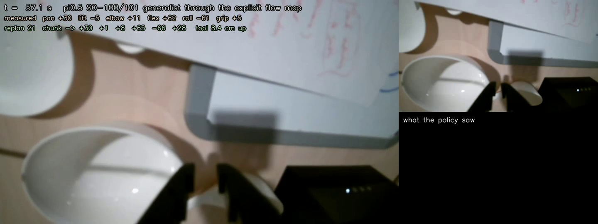
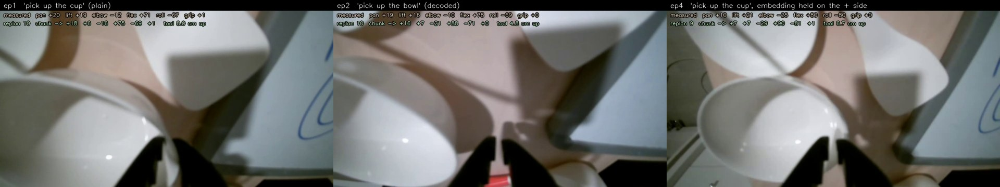
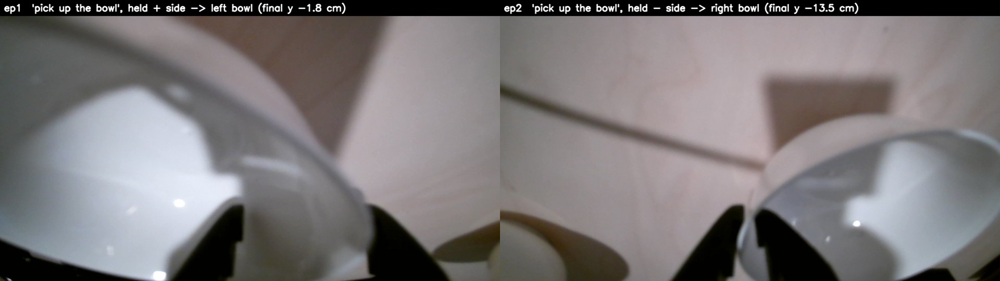
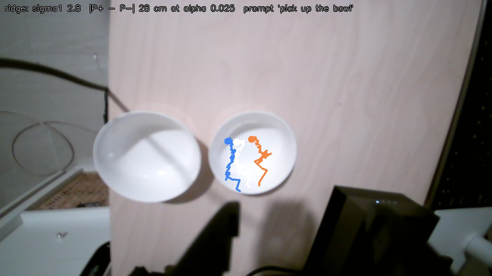
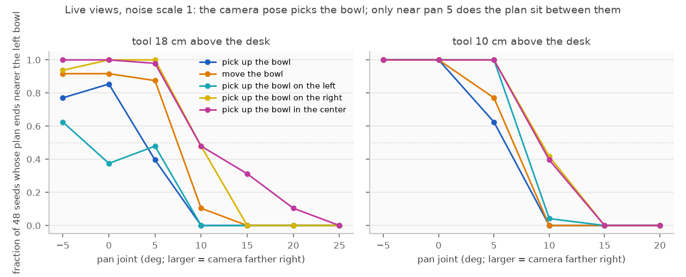
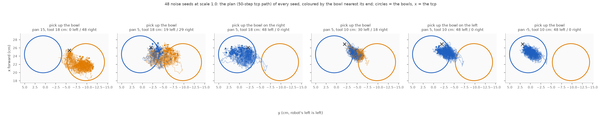
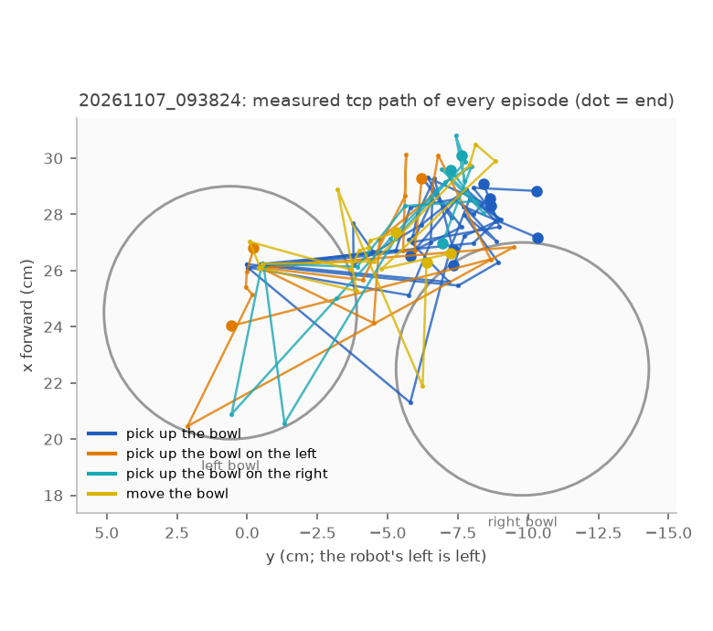

# pi0.5 on the real SO-101

The robot5 machinery (pi0.5 as an explicit, differentiable flow map; FTLE in noise space; the ridge in
prompt space; the simulator-free monitor) on a real arm: the LeRobot **SO-101** follower on this desk,
driven by the **pi0.5 SO-100/101 generalist** `hqfang/pi05-so100_101` (pi0.5 base fine-tuned on the
MolmoAct2 mixture of 1,209 community SO-100/101 datasets, 19 M frames). That checkpoint is the one that
grasped the eraser zero-shot from the Jetson Thor on 2026-10-26 (`simlab/docs_vla.md`); the arm's
driver, calibration, camera model and the execution safety come from
[simlab](~/Documents/GitHub/software/simlab) (`workspace/skills/so101/`), imported by path.

## Setup

Python 3.12, torch cu128, lerobot **at the checkpoint's own commit with its patch** (the saved
preprocessor names a custom sentencepiece step and the camera padding masks that only exist there;
that commit is version 0.6.2, the version robot4–6 were written against, so `robot5/pi05flow.py`
runs unchanged):

```bash
# from the project root
uv venv --python 3.12 .venv
uv pip install --python .venv/bin/python "torch>=2.11,<2.12" torchvision --index-url https://download.pytorch.org/whl/cu128
git clone --filter=blob:none https://github.com/huggingface/lerobot.git ~/Documents/GitHub/lerobot-pi05
cd ~/Documents/GitHub/lerobot-pi05 && git checkout b6ec0060779550c0a157ae34feb89e0cf86012a8
curl -sL https://huggingface.co/hqfang/pi05-so100_101/raw/main/code/lerobot.patch -o hqfang-pi05-so100_101.patch
git apply hqfang-pi05-so100_101.patch && cd -
uv pip install --python .venv/bin/python -e "$HOME/Documents/GitHub/lerobot-pi05[pi]" sentencepiece scipy matplotlib pyserial mujoco
uvx --from huggingface_hub hf download hqfang/pi05-so100_101        # 16.6 GB (fp32), into the HF cache
curl -o robot4/assets/paligemma_tokenizer.model https://storage.googleapis.com/big_vision/paligemma_tokenizer.model
```

The checkpoint ships its own PaliGemma tokenizer (`tokenizer/tokenizer.model`), which the saved
preprocessor resolves relative to the checkpoint; the big_vision copy is only for robot4/robot5.

**Hardware access.** The Waveshare bus adapter (CH343) is `/dev/ttyACM0`, owned by `root:dialout`:
`sudo usermod -aG dialout $USER` and log in again (or per boot `sudo setfacl -m u:$USER:rw /dev/ttyACM0`).
The wrist camera (`USB2.0_CAM1`, `/dev/v4l/by-id/...-video-index0`, MJPG 1280x720 at 30 fps) works
without it. `python arm7.py status` scans the bus, prints every servo's position/voltage/temperature and
saves a camera frame, moving nothing; with the bus unreadable it falls back to the camera alone.

**GPU.** The studies in robot4–6 ran on an RTX 5090 with everything in float32. This machine has an
RTX 3060 (12 GB), so `so101flow.load()` keeps the Gemma prefix (language model) in **bfloat16** and
SigLIP, the projector and the action expert in float32 (float64 for derivative checks): about 8 GB.
Two consequences, both handled in the code: the prefix is always computed at batch 1 (bf16 K/V depend
on the batch, robot4), and derivatives with respect to the prompt embedding use autograd only (reverse
mode for Jᵀw, forward mode by double backward for Jv): a finite-difference step of 1e-3 of the token
norm is below bf16 resolution. Noise-space Jacobians go through the expert only and are exact as before.

## Files

| File | What |
|---|---|
| `so101flow.py` | The generalist as a flow map on real observations: frame → 4:3 crop → letterbox → 224² into `camera_0` (slots 1–3 padded by the policy), state in the old SO-100 degrees (simlab's `to_so100_units`), QUANTILES unnormalisation, chunks → our degrees → **torch forward kinematics** (`Kin`, extracted from simlab's MJCF, checked against MuJoCo) → the gripper path in cm, the analogue of robot5's eef path. Commands `check`, `ftle`, `ridge`. |
| `arm7.py` | The real arm behind a small interface (simlab's `RealBackend`: Feetech bus + V4L2 camera), with the execution clamps of simlab's VLA client (ramp, low-pass, joint limits, per-step delta, gripper range, tool floor via FK). `status` moves nothing. |
| `busprobe7.py` | Servo-bus diagnostic, nothing moves: every ID at 1 Mbps, seven other baud rates, the raw bytes a ping gets back, the adapter's modem lines. Silence everywhere means the motors have no power or no data line. |
| `thor_py.sh` | Python launcher for the Jetson Thor (NVIDIA's ARM torch needs the pip cuDNN/NVPL libraries on the loader path; keeps the working directory, unlike `~/so101_vla/run_pi05.sh`). |
| `video7.py` | Proof video of a run: the wrist camera as recorded at 8 fps with time, measured joints, replan and monitor verdict drawn in, and the frame the policy saw (with the ridge overlay when there was one) beside it; H.264 via imageio-ffmpeg when available. |
| `modes7.py` | Noise-space modes with two bowls: `screen` (many seeds per observation × prompt × noise scale, plans labelled by the nearest bowl, choice coordinate along the bowl axis, optional prompt ridge), `views` (move the arm through poses and capture a frame + state at each), `lcs` (segment bisection, stretching, FTLE and v₁ margins between two seeds of different modes), `fig` / `fan` / `table`. |
| `live7.py` | Closed loop through the flow map with seeded noise, replan every `--exec` actions; at every replan the fast monitor (fresh v1 by one power iteration, jump along ±v1 at 2.5 % of the token norm) or the full ridge test; `--stop-on-ridge` holds the arm at the first ridge and draws the two side paths into the wrist frame (the question). `--dry-run` computes everything and moves nothing; `--no-bus` also skips the servo bus. Logs frames, chunks and diagnostics to `runs/<timestamp>/`. |

## Running on the Thor

The arm and its camera hang off the Jetson Thor (`plov.local`, direct Ethernet from the workstation), which
already has the patched lerobot (`~/so101_vla/venv_pi05`), simlab (`~/simlab`) and 122 GB of unified
memory, so the flow map runs there in full float32. Mirror the repo and run through the launcher:

```bash
rsync -az --exclude .venv --exclude .git --exclude out/ --exclude runs/ flow-matching-lcs/ wbm3@plov.local:~/flow-matching-lcs/
ssh wbm3@plov.local
sudo setfacl -m u:$USER:rw /dev/ttyACM0                      # after every boot (or usermod -aG dialout)
cd ~/flow-matching-lcs/robot7
./thor_py.sh arm7.py status                                  # servos, joints, a frame; nothing moves
VLM_DTYPE=float32 ./thor_py.sh so101flow.py all --live       # check + FTLE scan + prompt ridge, one model load
./thor_py.sh live7.py run --dry-run --duration 30            # the loop with the real state, no motion
./thor_py.sh live7.py run --duration 75 --exec 40 --hz 30 --max-step-deg 2 --monitor off   # the arm moves
./thor_py.sh video7.py runs/<timestamp>                      # -> videos/<timestamp>.mp4
```

The checkpoint's weights blob had been pruned from the Thor's cache; copying the workstation's
`~/.cache/huggingface/hub/models--hqfang--pi05-so100_101/` directory with `rsync --size-only` restores it
(16.6 GB, a few minutes over the link). The dry pass (`--dry-run --no-bus`) caught a device bug in the
kinematics helper before any motion; the live loop's first replan is always computed without motion and
the run aborts if the chunk starts more than `--max-start-jump` (15°) from the measured pose, the signature
of a wrong joint convention.

### First live run (2026-11-06, `videos/20261106_215326.mp4`)



`live7.py run --duration 75 --exec 40 --hz 30 --max-step-deg 2 --monitor off` on the Thor, from the folded
rest pose, prompt "Pick up the blue eraser and put it in the black bin.", with neither object on the desk
(white cups, a mug and a whiteboard instead): 30 replans in 75 s (policy 0.8 s per replan with the bf16
prefix, 40 actions executed per chunk at an effective 20 Hz, the servo driver's 50 ms floor), every chunk
starting within 0.3–3 deg of the measured joints, 0 tool-floor holds, the per-step clamp (2 deg) active
in 28 of 29 executed chunks. Behaviour: the wrist rolled to the camera-on-top pose within the first
replans (−100 → −85 deg) and the arm idled near rest for ~40 s; then it unfolded (shoulder lift −107 →
+26 deg, elbow 91 → −13, pan to +25), opened the jaws to 38 % over the white cups and closed them to 17 %
with the tool 3 cm above the desk: a reach-and-grasp at the nearest graspable thing. The explicit flow map
drives the real arm with the same safety envelope as simlab's client; the video is the wrist camera at
8 fps with the measured state, replan index and chunk drawn in, and the policy's own frame beside it.
The arm holds its last pose with torque on after a run (`arm7.py release` to relax it).

Next: the same run with the eraser laid radially ~25 cm in front of the base and the box upright to its
right, then `--monitor fast` (the online prompt ridge, ~20 s per replan on the Thor in float32, less with
the bf16 prefix) and `--stop-on-ridge` for the stop-and-ask demonstration.

### At a decision state: the gripper over a cup (`so101flow.py scan --live`)

State = where the first live run left the arm (joints `[15.6, 4.1, −10.1, 89.2, −69.3]`, gripper 24 %,
tool 3 cm up): a white cup directly under the jaws, a plate and a square dish farther away, a whiteboard
on the right, nothing blue, no bin. Thor, float32, 4 noise seeds, 2 noises in the prompt-space plan.

**Noise space: still no ridge.** FTLE of the executed 15 steps −1.5 to −1.7 (full chunk −0.4 to −0.9), v₁ has
99.5 % of its energy in the 6 task dims, and along v₁ the tcp path moves 0.2–0.4 cm at s = 1 and 0.8–1.9 cm
at s = 4 (random directions 0.1 and 0.3–0.4 cm) with no jump anywhere (≤ 0.07 cm per Δs = 0.1); the
seed-to-seed spread of the executed path is 0.6 cm. As on LIBERO and PushT, this pi0.5's noise never
decides anything: there is no mode boundary in z to find.

**Prompt space: ridges for every prompt, the absent object the most fragile.** Same table as before
(d = plan displacement along ±v₁ at α × token norm, cm in the 150-D path norm; random ≤ 0.4 cm at α 0.025):

| prompt | σ₁ | d at α 0.025 / 0.05 / 0.1 | ‖P₊ − P₋‖ at 0.025 | step | side path ends (cm, base frame) +v₁ / −v₁ |
|---|---|---|---|---|---|
| pick up the cup | 3.1 | 16 / 28 / 40 | 30 | no | (23.4, −6.6) / (26.2, −7.9) |
| pick up the left cup | 3.6 | 17 / 24 / 30 | 31 | no | (22.2, −5.1) / (25.7, −7.2) |
| pick up the right cup | 3.4 | 20 / 29 / 33 | 33 | yes | (25.2, −3.3) / (24.8, −8.2) |
| pick up the object | 5.3 | 23 / 30 / 33 | 39 | yes | (24.1, −11.6) / (24.8, −5.3) |
| Pick up the blue eraser and put it in the black bin. | **10.5** | **40** / 50 / 51 | **78** | yes | (22.1, −3.5) / (22.3, −14.7) |
| put the cup in the bowl | 3.7 | 23 / 37 / 48 | 37 | no | (26.9, −8.1) / (23.7, −5.4) |

Every prompt has a direction in which 2.5 % of the token norm moves the 50-step plan by 16–40 cm (random
directions: 0.2–0.4 cm), and the sides of the ridge differ mostly laterally (y, the robot's left–right):
the language axis at this state is *which thing on the desk*. The most fragile prompt by far is the
trained-style one whose object is absent (σ₁ 10.5, both sides a full mode apart at the smallest α), the
same ordering pridge5 found on LIBERO: prompt fragility is a property of the prompt in this scene, and
the specific prompts with a visible target ("the cup") are the least fragile. The step / ramp criterion
scaled from LIBERO (10 cm, 60 % of the α 0.1 jump) is marginal here (3 of 6 flagged) and would need
recalibration on this arm before it serves as a trigger.

**Decoding the ridge into words** (`decode`, 9,663 dictionary words × every prompt slot, verified by plan
projection, 100 s per prompt): for "pick up the cup" the −v₁ side decodes to **"pick up the bowl"**
(projection −0.94, i.e. its plan sits on the −v₁ side of the ridge), the +v₁ side to junk ("ing up the
cup", −0.01), and the executed plan sits halfway between the two sides (λ₀ 0.48): the policy reads the white
thing under the jaws as cup-or-bowl and the two readings plan differently. For "pick up the object" the
best words are weak ("pick up the remote" −0.22 on one side, "pick press the object" +0.55 on the other):
multi-token alternatives (plate, dish) are out of reach of single-slot substitution, as monitor5 found.
Outputs: `out/ftle.json`, `out/ridge.json` (+ `v1_*.npy`), `out/decode_pick_up_the_cup.json`.

### Executing the two sides of the ridge (`live7.py run --episode ... ::+ / ::-`)

The LIBERO result that mattered for hardware was that holding the prompt embedding on either side of
the ridge sent the robot to the stove or to the plate. Same test on the arm: eight 40-second episodes
from one start pose (joints `[15.6, 4.1, −10.1, 89.2, −69.3]`, gripper 24 %, re-entered through a raised
pose before each episode), one model load per run, wrist camera recorded, outcomes from the measured
joints through the forward kinematics (`report7.py`; cm, base frame, x forward, y left, z up). "Held ±"
= the prompt's own embedding plus ±0.1 × token norm along v₁ at every replan, v₁ computed at the start
state inside the run (σ₁ 2.0) and oriented so that + is the side whose plan ends farther left.



| run / ep | prompt | held | seed | final tcp (cm) | y range (cm) | gripper (%) | tool z (cm) | video |
|---|---|---|---|---|---|---|---|---|
| 1 / 0 | pick up the cup | | 0 | (27.9, −6.1, 8.8) | −8.2 … −1.6 | 0 … 36 | 4.8 … 15.2 | `videos/20261106_224126_ep0.mp4` |
| 1 / 1 | pick up the cup | | 1 | (28.5, −8.7, 5.1) | −9.2 … −5.8 | 0 … 37 | 4.9 … 15.8 | `…_ep1.mp4` |
| 1 / 2 | pick up the bowl (decoded −side word) | | 2 | (26.5, −7.6, 5.3) | −8.8 … −4.3 | 0 … 32 | 3.8 … 16.0 | `…_ep2.mp4` |
| 1 / 4 | pick up the cup | + | 4 | (28.1, −4.7, **12.0**) | −5.7 … −2.2 | 0 … 35 | 5.8 … 15.7 | `…_ep4.mp4` |
| 2 / 0 | pick up the cup | − | 5 | (25.0, **−11.0**, 6.5) | **−11.0** … −3.3 | 0 … 43 | 4.5 … 13.6 | `videos/20261106_224934_ep0.mp4` |
| 2 / 1 | pick up the cup | − | 6 | (25.6, −4.7, 6.8) | **−10.1** … −4.5 | 0 … 50 | 4.9 … 12.7 | `…_ep1.mp4` |
| 2 / 2 | pick up the cup | + | 7 | (28.8, −7.4, 4.1) | −7.5 … −3.3 | 0 … 36 | 3.8 … 14.6 | `…_ep2.mp4` |

Side plans at the start state: run 1, + ends at (28.7, −2.8, 7.5) and − at (26.5, −4.8, 2.5); run 2 (a fresh
v₁ at the re-entered pose), + at (28.6, −2.6, 3.4) and − at (25.6, −12.1, 5.3).

- **The plain prompt and its decoded alternative do the same thing**: descend on the cup, close the jaws
  (gripper to 0) at 5–9 cm, with the lateral excursion never beyond y = −9.2. "pick up the bowl" is a
  paraphrase for this policy in this scene (its plan sat on the −v₁ side of the ridge by projection, but
  the ridge's two sides at α 0.025 differ by 1–3 cm at the endpoint; the words do not change the grasp).
- **Holding the − side sends the arm to the right, where no plain episode went**: both − episodes reach
  y = −10 to −11 (the − side plan of run 2 ended at −12.1), one ends there, the other swings back; both
  still open and close the jaws (0–50 %) without a cup under them.
- **The + side is mixed**: in run 1 it did what its side plan said (up and left, tool at 12 cm, jaws open
  above the cup, no grasp); in run 2 the fresh v₁'s + side plan ended low (z 3.4) and the arm descended and
  grasped like the plain runs. With one or two episodes per side this is a steering effect, not a
  bifurcation: the 50-step plan is pushed a mode apart (‖P₊ − P₋‖ 65 cm at α 0.1) but the closed loop
  re-decides at every replan from the new image, and the perturbation only wins where it points at a
  different reachable thing (right: the dish side; up-left: away from the cup).
- Same caveat as LIBERO: v₁ changes with the state (run 1 vs run 2 at nominally the same pose have
  different side-plan heights), so a held direction must be the one computed at the state it is applied
  from, and the + / − labels only mean anything relative to that v₁.

**Grasp strength.** The policy commands the jaws fully closed and the servo stalls on the cup rim at
simlab's holding-torque cap (`gripper_torque_permille` 350, set for the foam eraser), so the grasps were
loose; the Thor's `real_config.json` now has 700 for cups (applied when torque is enabled).

### The monitor online, and the stop-and-ask trigger (`live7.py run --monitor fast --stop-on-ridge`)

The simulator-free monitor of robot5 (fresh v₁ by power iteration, the jump test along ±v₁ at every
replan) ran on the arm under the absent-object prompt from the same start pose, with the ridge threshold
raised to `D_JUMP=30` cm so that only the strongest ridges count (every prompt jumps 16–40 cm at α 0.025
at this state, see the scan table). Two power iterations and three α per replan cost **29 s** on the Thor
in float32 (the LIBERO design on the RTX 5090 budgeted 0.3–1.0 s), so the arm paused half a minute per
chunk; `videos/20261106_225725.mp4`. The jumps along v₁ were 21 / 35 / 48 cm and then 17 / 30 / 44 cm at
α 0.025 / 0.05 / 0.1 (σ₁ 3.6 and 2.7): ramps, not steps, so the trigger did not fire and the policy
executed its plan, panning 22° toward the right-hand side of the desk looking for an eraser that is not
there. The question overlay itself (`draw_question`: the executed plan and the two side paths projected
into the wrist frame through simlab's camera model) was exercised in the camera-only dry pass
(`runs/20261106_195555/ask_000.png`).

What this says about the hardware version of the stop-and-ask loop: (1) the online ridge test and the
overlay work on a real arm from one observation, with no simulator; (2) at this arm's decision states the
prompt ridge is a smooth ramp over α 0.025–0.1 for every prompt tried, so the LIBERO step criterion has no
clean 2-way question to ask here, the same limitation monitor v2 reported (recall 2 of 18); a scene with two
identical graspable objects ("pick up the cup" with two cups) is the test that could show a step; (3) the
monitor needs the bf16 prefix, one iteration and one α (about 8 s per replan on the Thor), or the 5090,
before it can run at the chunk rate.

### Two identical bowls: the choice, the question, and the two answers executed (`videos/demo_*.mp4`)



Scene: two identical white bowls side by side, the wrist camera 24 cm above them at the vantage pose
(joints `[15, −10, −25, 95, −69]`, gripper 30 %, tool 18 cm up), prompt **"pick up the bowl"**, lights on
(the policy is blind below ~10 of 255 mean brightness; a dark room earlier gave flat chunks). One model
load, every episode from the vantage pose (re-entered through a raised pose), 35 s each, recorded.

| ep | prompt | held | final tcp (cm) | y range (cm) | gripper (%) | tool z (cm) |
|---|---|---|---|---|---|---|
| 0 | pick up the bowl (monitor on) | | held at the start pose | | | 18 |
| 1 | pick up the bowl | **+** | (24.2, **−1.8**, 3.6) | −8.4 … −1.8 | 0 … 44 | 3.6 … 18.7 |
| 2 | pick up the bowl | **−** | (29.2, **−13.5**, 5.7) | −14.3 … −3.0 | 0 … 33 | 4.7 … 18.2 |
| 3 | pick up the left bowl | | (26.7, −6.4, 10.8) | −10.9 … −5.8 | 0 … 34 | 3.8 … 18.6 |
| 4 | pick up the right bowl | | (26.3, −5.4, 9.5) | −8.0 … −0.7 | 0 … 33 | 2.7 … 18.2 |

- **The two sides of the prompt-space ridge are the two bowls.** With the prompt unchanged, the embedding
  pushed 0.1 × token norm to the + side (the side whose 50-step plan ends farther left) takes the arm to
  the left bowl (y −1.8 cm, jaws on its rim at 3.6 cm), and to the − side takes it to the right bowl
  (y −13.5 cm), 12 cm apart, each descending and closing the jaws on its bowl. v₁ came from the question
  episode's ridge test at the start pose (σ₁ 4.2, jumps 36 / 66 / 72 cm at α 0.025 / 0.05 / 0.1) and was
  reused unchanged for both sides.
- **Words do not steer this policy**: "pick up the left bowl" drifted right (to y −10.9) and "pick up the
  right bowl" left (to y −0.7), i.e. the generalist does not ground left / right, while the embedding
  direction found from the ridge does. This is the hardware version of robot5's finding that the
  language axis that matters is the policy's own, not a word's.
- **The question.** At the vantage pose the two side plans end only 4.7 cm apart in the table plane
  (the chunk only begins the descent; the closed loop amplifies the lateral choice to 12 cm), which is
  why the LIBERO step criterion is useless here and the question trigger is the lateral separation of
  the two side paths (`--ask-sep`). The first monitored episode used 5 cm and did not fire; the rerun
  with 3.5 cm is the question episode of the demo video.



The question episode (`runs/20261106_234800`): the fast test at replan 0 (2 iterations, 29 s) found
σ₁ 2.5 with jumps 16 / 31 / 44 cm along v₁ and the side paths 3.5 cm apart in the table plane, so the arm
held; the full test on the frozen pose (4 iterations, 5 α, a random direction, 70 s) gave σ₁ 2.8, jumps
15 / 24 / 32 / 36 / 39 cm along v₁ against 0.3 / 0.7 / 1.3 / 2.6 / 5.5 for a random direction, ‖P₊ − P₋‖
28 cm at α 0.025, the + side ending at (25.8, −5.4, 3.5) and the − side at (26.4, −8.0, 6.3) cm. The
decoder (99 s) named the + side "pick up the balls" (projection +0.70) and the − side junk ("pick
peugeot the bowl", −0.61): two white bowls read as balls, and no single word for "the other one". The
held sides of the main run then executed these two directions to the two bowls.

**What the demo shows and does not.** From one observation and no simulator, the policy's own
language axis at this state (v₁ of the plan with respect to the prompt tokens) separates the two bowls,
the robot can stop and show both candidate paths, and pushing the prompt embedding along that axis
executes either choice on the real arm, which words cannot do with this generalist. What it does not show
is a bifurcation inside one chunk: the sides differ by a few cm at the plan level and the closed loop
(replanning from the new image) turns that into the 12 cm choice, the same mechanism as robot5's
"move the bowl" case where the plan only commits once it reaches past the grasp.

### Does the noise give two paths for an ambiguous prompt and one for a specific one? (`modes7.py`, 2026-11-07)

The question of the day: with two identical bowls, "pick up the bowl" / "move the bowl" should give two plans (one
per bowl) and "move to the bowl on the left / right" one. `modes7.py screen` samples many noise seeds at one
observation and prompt, pushes every chunk through the FK, and labels each plan by the bowl nearest its end
(bowls located by unprojecting their pixel centres onto the rim plane at the camera pose of the view); the
"choice coordinate" q is the path end projected on the bowl-to-bowl axis (0 = midpoint, + = left bowl, the
bowls are 9–10.5 cm apart). Everything below is on the Thor in float32, 48–96 seeds per cell.



**1. From last night's vantage view (recorded frame), the normal-scale noise never chooses.** 12 prompts
(6 ambiguous, 6 with left / right), 48 seeds each: every seed of every prompt ends at the right bowl (q −3 ± 0.8
cm, the bowl under the camera centre), seed-to-seed spread of the path end 1.1 cm. Scaling the noise
(z ~ N(0, T²I)) opens the other bowl for every prompt alike: 96 seeds of "pick up the bowl" send 0 / 0 / 1 / 29 /
51 to the left bowl at T = 1 / 1.25 / 1.5 / 2 / 3, the spread of q grows 0.7 → 1.1 → 1.6 → 3.8 → 8.0 cm, and the
three other prompts ("move the bowl", "… on the left", "… on the right") are within ±5 seeds of those numbers
(`figs/temperature_20261107.png`). So the second basin exists but has no mass at T = 1 from that view, and the
words do not move the balance. Nineteen phrasings at T 1.5 / 2 (96 seeds; anchors like "under the gripper",
"next to the black box", "the other bowl", "closest to you", absent objects "cup", "mouse"): all 0–7 % left at
T 1.5 except **"pick up the bowl in the center" (27 %, 48 % at T 2)**, the one phrase this generalist reads as
pointing somewhere. The prompt-space ridge of every prompt at this view has both sides ending at the right bowl
(sides 1–4.5 cm apart) except "move to the bowl on the left", whose + side ends on the midpoint.

**2. Along last night's recorded descents, the chunk is unimodal at T = 1 at 11 of 13 states.** The two
exceptions are the states with the jaws 4–5 cm above the desk between the bowls (ep1 replans 4 and 9: 40 / 8 and
29 / 19 for "pick up the bowl"), and there the ends form one broad cloud straddling the midpoint (spread 2.6 cm,
largest gap 1.2 cm), not two clusters. The same pose seen in two frames a minute apart can differ ("pick up the
bowl on the right" at the vantage pose: 0 / 48 in one frame, 13 / 35 in the next): the plan is sensitive to the
image, not to the noise.

**3. Live views: the camera pose picks the bowl, and the symmetric view is where the plans fan out.** With the
arm moving through 13 poses this morning (`modes7.py views`: pan −5 … 25° at tool heights 18 and 10 cm, a settled
frame and the measured state at each, `runs/20261107_083621_views`), 48 seeds × 5 prompts × T 1 / 1.5 per view:

| view (pan, tool height) | pick up the bowl | move the bowl | … on the left | … on the right | … in the center |
|---|---|---|---|---|---|
| pan 15–25, 18 cm (camera over the right bowl) | 0 / 48 left | 0 / 48 | 0 / 48 | 0 / 48 | 0–15 / 48 |
| pan 10, 18 cm | 0 / 48 | 5 / 48 | 0 / 48 | 23 / 48 | 23 / 48 |
| **pan 5, 18 cm** (bowls symmetric about the image centre) | **19 / 48** | 42 / 48 | 23 / 48 | **48 / 48** | 47 / 48 |
| pan 0 … −5, 18 cm (camera over the left bowl) | 37–41 / 48 | 44 / 48 | 18–30 / 48 | 45–48 / 48 | 48 / 48 |
| pan 10–20, 10 cm | 0 / 48 | 0 / 48 | 0–2 / 48 | 0–20 / 48 | 0–19 / 48 |
| **pan 5, 10 cm** | **30 / 48** | 37 / 48 | **48 / 48** | **48 / 48** | **48 / 48** |
| pan 0 … −5, 10 cm | 48 / 48 | 48 / 48 | 48 / 48 | 48 / 48 | 48 / 48 |



- Ten degrees of pan (≈ 4 cm of camera travel) switch every prompt from one bowl to the other: the policy goes
  to the bowl under the camera, and the words left / right / center do not override the view at any pose.
- At the symmetric view the ambiguous prompts do give a spread of plans over both bowls (19 / 48 and 30 / 48 for
  "pick up the bowl", 42 and 37 for "move the bowl"), while the longer prompts collapse the spread to a single
  tight cluster (spread 0.9–1.7 cm): "…on the left", "…on the right" and "…in the center" all 48 / 48 **left** at
  pan 5, 10 cm. So "specific → one path" holds for this generalist, but the one path is the same bowl whatever
  the word says: the extra words make the policy decisive, not correct.
- The "two paths" at the plan level are not two clusters. The ends of the 48 plans form one continuous cloud
  across the midpoint (largest gap 0.3–0.8 cm against a 2–4 cm spread), and the FTLE along the straight segment
  between a left-bowl seed and a right-bowl seed is −1.2 everywhere (contracting, as at every other state of
  this policy); from either seed the plan moves 0.2–0.3 cm per 0.1 noise units along v₁. The bowl boundary in
  noise space is a level set of a smooth, contracting map, not an LCS ridge, exactly the "soft label boundary"
  case of robot2 and the GMM study (fig3 there): FTLE measures sensitivity, not the number of modes. The
  commitment to one bowl happens in closed loop, as robot5 found for pi0.5 on LIBERO.

**4. Closed loop by seed: the view decides, the words shift the boundary, the noise does not split the
ambiguous prompt.** The LIBERO result of robot5 (underspecified prompts split 6 : 2 by seed in closed loop while
the first chunk is unimodal) was tested on the arm with `live7.py` multi-episode runs from a fixed start pose
(vantage height, 18 cm; pan chosen per episode), replan every 40 actions, 25 s, a 6 cm tool floor so that no
bowl is touched, every episode its own seed, outcome = the bowl nearest the final tcp (`report7.py
--bowls-cm`). 71 episodes in five runs (`runs/20261107_09{1313,2721,3824,5205}` and `runs/20261107_100349`; two
episodes of the second run were stopped by the 15° start-jump guard before moving and are not counted):

| start pan (deg) | pick up the bowl | move the bowl | pick up the bowl on the left | pick up the bowl on the right | pick up the bowl in the center |
|---|---|---|---|---|---|
| +5 (bowls symmetric in the image) | 0 left / **6** right | 0 / 3 | 0 / 3 | 0 / 3 | |
| +2.5 | 0 / 5 | | 1 / 2 | 1 / 2 | 1 / 0 |
| +1.25 | 0 / 4 | 1 / 2 (the "left" one stopped on the midpoint) | **2 / 1** | 0 / 3 | |
| 0 | 0 / 4 | | | | |
| −2.5 | 0 / 3 (one on the midpoint) | | | | |
| −5 | 0 / 3 | | **2 / 0** | 2 / 1 | |
| **−6.25** | **5 / 1** (the right one stopped on the midpoint) | | 2 / 1 (the right one on the midpoint) | 3 / 0 | |
| −7.5 (tool starting over the left bowl) | **2 / 0** | | | | |



- **The ambiguous prompt is deterministic given the start pose.** "pick up the bowl" went to the right bowl from
  every start down to pan −5 (25 of 25 episodes, six different starts) and to the left bowl from −6.25 and −7.5
  (7 of 8, the eighth stopped on the midpoint): the closed-loop boundary sits near −6°, eleven degrees to the
  left of the view that centres the bowls (+5°), because the right bowl is the attractor of the loop: whatever
  the first chunk does, the next view (lower, further right) sends the arm right. The seed only decided within
  about a degree of that boundary (5 : 1 at −6.25), the LIBERO situation of robot5 (6 : 2 at one initial state);
  everywhere else one start pose gives one bowl. The live first chunk from pan +5 already swung the pan to 22°
  (straight at the right bowl) although the recorded frame of the same pose had its 48 plan ends around the
  midpoint: a frame taken minutes apart moves the whole plan distribution by a few cm, and the loop amplifies
  that into a choice. This is the hardware version of robot5's "the plan commits, then re-decides": the decision
  is in the closed loop, not in the noise.
- **The specific prompts are the ones the seed decides.** "…on the left" went left 1 / 3 at pan +2.5, 2 / 3 at
  +1.25 and 2 / 2 at −5, where the plain prompt went right every time: the word "left" shifts the boundary several
  degrees to the right, the only consistent word effect found today. "…on the right" never pulled right (2 / 3,
  3 / 3, 1 / 3, 0 / 3 right at +2.5, +1.25, −5, −6.25) and from the left-biased starts went left more often than the
  plain prompt.
- So the hypothesis of the day (ambiguous → two paths by noise, specific → one) does not describe this
  generalist on this scene. What produces two distinct paths from one observation is the prompt-embedding
  direction v₁ (yesterday's demo, both bowls reached on command) or a noise scale ≥ 2; what produces one path is
  any prompt from any view that is not exactly on the loop's boundary. Videos: `videos/seeds_20261107_*.mp4`
  (per run, selected episodes with the prompt, seed, start pan and outcome; `seedvideo7.py`).


Outputs: `out/modes_20261107_080353.json` (vantage, 12 prompts, T 1 / 2, with ridges), `out/modes_20261107_082540.json`
(19 phrasings, T 1.5 / 2, 96 seeds), `out/modes_20261107_083701.json` (temperature sweep), `out/modes_20261107_080541.json`
(recorded descents, ep1), `out/modes_20261107_084422.json` (13 live views), `out/lcs_*.json`; `.npz` files hold every
seed's path. Timing on the Thor: 48 seeds in one batch 7 s, 2 iterations of the prompt-space ridge 65 s per prompt
(that is what made the first screen slow), 300 × 1600 fp32 Jacobian 45 s per seed.

### Videos

| file | what |
|---|---|
| `videos/20261106_215326.mp4` | first live run from rest, prompt "Pick up the blue eraser…", no eraser on the desk: roll to camera-on-top, idle, unfold, reach and close on a cup |
| `videos/20261106_224126_ep{0,1,2,4}.mp4` | from the start pose over the cup: "pick up the cup" ×2, "pick up the bowl" (decoded), embedding held on the + side |
| `videos/20261106_224934_ep{0,1,2}.mp4` | held − side ×2, held + side |
| `videos/20261106_225725.mp4` | the online monitor under the absent-object prompt (29 s per replan), no trigger |
| `videos/20261106_233849_ep{1,2}.mp4` | two bowls, "pick up the bowl", embedding held on the + side (left bowl) and the − side (right bowl) |
| `videos/20261106_233849_ep{3,4}.mp4` | two bowls, "pick up the left / right bowl" by words (no steering) |
| `videos/seeds_20261107_{091313,092721,093824,095205,100349}.mp4` | closed loop by seed (2026-11-07): selected episodes of each run with the prompt, seed, start pan and outcome card; 2× speed, 6 cm tool floor |
| `videos/seeds_demo_20261107.mp4` | the runs from pan +5, +1.25, −5 / −7.5 and −6.25 concatenated (384 s): the same prompt from the same pose with different seeds goes to the same bowl, except within a degree of the loop's boundary |
| `videos/demo_20261106_233849.mp4` | the assembled demo (177 s): the question episode (stop, two paths drawn into the wrist view, decoded words), then each answer executed, then robot5's LIBERO clip as the simulation counterpart |

## Observation and action contract (what the checkpoint speaks)

- State and actions: `[shoulder_pan, shoulder_lift, elbow_flex, wrist_flex, wrist_roll, gripper]`, joints
  in LeRobot's 2024–25 manual-calibration degrees (0 = arm stretched horizontally, rest ≈ `[0, 190, 178,
  60, 0, 1]`), gripper 0–100. Our convention (simlab, `RealBackend`) is degrees about LeRobot's 2025
  calibration middle pose; the map is `old = SO100_OFFSET + SO100_SIGN · ours` with the wrist roll
  inverted about the camera-on-top roll (−89°). `chunk_deg_t` is that map in torch, so the gripper path is
  differentiable in the chunk.
- Images: the policy's own `resize_with_pad` letterboxes whatever it gets; we hand it the 4:3 centre crop
  of the 16:9 wide-angle frame, letterboxed to a square, as simlab's server did for the runs that grasped.
- The prompt: `Task: <text>, State: <256-bin tokens>;\nAction:`, PaliGemma sentencepiece. The prompt's
  own tokens (between `Task:` and `, State:`) are the slots the prompt-space ridge perturbs.

## Results

### The generalist is an exact flow map on real observations (`so101flow.py check`)

Workstation (RTX 3060, Gemma prefix in bf16, expert fp32 / fp64), one live wrist frame at the rest
pose, 2 seeds:

| check | result |
|---|---|
| explicit expert flow vs lerobot `sample_actions`, same noise (fp32) | max diff 1.2e-7 (actions up to 0.96) |
| ∂Φ/∂z (reverse mode, fp64, first 15 chunk steps = 90 rows × 1600) vs central FD, 6 random directions | 3.8e-9 relative |
| torch FK vs MuJoCo, 64 random poses | 1.7e-16 m |
| FTLE of the executed 15 steps | −2.8 (contracting 16×, as pi0.5 on LIBERO / PushT) |
| chunk start vs measured pose | 1.9 / 3.8 deg (seeds 0 / 1): the old-SO-100 unit map is right |
| load / prefix / flow / 90×1600 fp64 Jacobian | 170 s / 0.18 s / 0.25 s per seed / 220 s (3060); GPU 9.5 GB |

At the rest pose over a bare desk the policy barely moves (path end 1.7 cm from the tcp, seed spread
0.3 cm), as expected with no object in view.

Jetson Thor (everything float32, `thor_py.sh so101flow.py all --live --no-bus`), same pose, live frame:
flow vs `sample_actions` 1.8e-7, Jacobian vs FD 2.8e-9, FTLE −2.7, chunk start 2.6 / 4.0 deg from the
pose. Timing on the Thor: load 163 s, prefix 0.28 s, flow 0.8 s per seed, 90×1600 Jacobian 13 s per
seed in fp32 (fp64 is 30× slower on the Jetson: 419 s for one seed, so run the FD check on the
workstation or with `--seeds 1`).

### Noise space at the rest pose: unimodal and contracting (`so101flow.py ftle`)

Thor, live frame at the rest pose, bare desk, 2 seeds, `GAIN`-free (the plan is the tcp path from
the chunk's absolute joint targets):

| quantity | seed 0 | seed 1 |
|---|---|---|
| FTLE of the executed 15 steps / the full chunk | −1.42 / −0.53 | −0.70 / −0.16 |
| energy of v1 in the 6 task noise dims (of 32) | 0.997 | 0.997 |
| tcp-path displacement along v1 at s = 1 / 4 (noise units) | 0.6 / 0.7 cm | 0.6 / 0.8 cm |
| same along a random direction | 0.1 / 0.2 cm | 0.1 / 0.3 cm |
| largest path jump between neighbouring points (Δs = 0.1) along v1 | 0.12 cm | 0.13 cm |

Seed-to-seed spread of the executed path 0.30 cm. Four noise units along v1 move the plan by less
than a centimetre and nothing jumps: no label-free ridge, no mode boundary within |s| ≤ 4. As in
robot4, the flow only listens to the task dims of the padded 32-wide noise (99.7 % of v1). Same
picture as pi0.5 on LIBERO and PushT: at a state with nothing to decide the chunk flow contracts.

### Prompt space at the rest pose: a steep direction, no step (`so101flow.py ridge`)

Top singular direction v₁ of the 50-step tcp path with respect to the prompt-token block (4 power
iterations, autograd only), displacement of the plan along ±v₁ at α × token norm (norm ≈ 220–240):

| prompt | σ₁ | d(α) along ±v₁, α = 0.025 / 0.05 / 0.1 / 0.2 / 0.4 (cm) | random direction | ‖P₊ − P₋‖ at α = 0.025 |
|---|---|---|---|---|
| "Pick up the blue eraser and put it in the black bin." | 2.9 | 11.5 / 16.7 / 20.1 / 18.9 / 17.4 | 0.1 / 0.1 / 0.2 / 0.5 / 1.0 | 22.7 cm |
| "pick up the object" | 1.5 | 7.6 / 10.2 / 11.1 / 9.2 / 8.8 | 0.2 / 0.3 / 0.7 / 1.4 / 2.2 | 12.3 cm |

The plan is 100× more sensitive along v₁ than along a random direction (a 2.5 % move of the prompt
tokens along v₁ changes the 50-step path by 11–12 cm in the 150-D norm, about 1.5 cm per step), but
the profile saturates smoothly between α 0.025 and 0.1: a ramp, not the step the LIBERO drawer
prompts showed, so `is_step` is False for both. The two side paths end 1–3 cm apart. With no object in
view there is no decision for the language to flip; this is the baseline the online monitor compares
against once the eraser and the bin are on the desk. Cost on the Thor: v₁ 34 s (4 iterations), 21
plans 36 s; the fast monitor (1 iteration, 3 α, no random direction) is about 20 s per replan in
float32, so the live loop uses the bf16 prefix.
